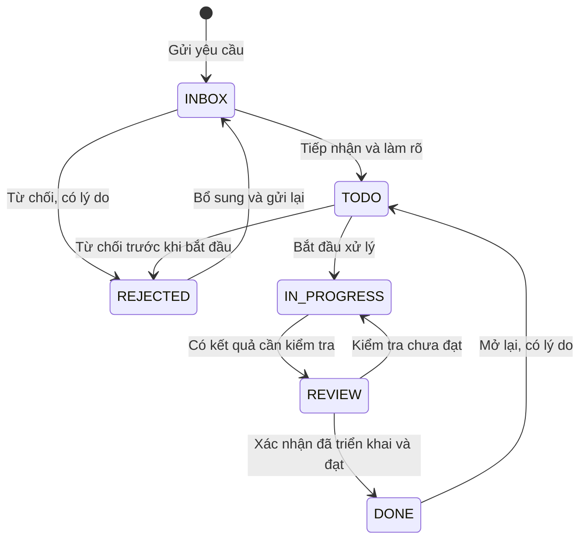

# Đặc tả — Quản lý công việc nội bộ CMS

- Ngày: 17/10/2026.
- Trạng thái: bản thiết kế đề xuất, chưa triển khai.
- Phạm vi đã xác nhận: module nội bộ trong CMS; backend ở API/shared.
- Tài liệu kỹ thuật: [TDD_QUAN_LY_CONG_VIEC_KANBAN.md](TDD_QUAN_LY_CONG_VIEC_KANBAN.md).

## 1. Mục tiêu

Có một nơi để nhân viên gửi yêu cầu tính năng, báo lỗi, trao đổi và theo dõi tiến độ. Người xử lý biết việc được giao, mức ưu tiên, hạn hoàn thành và điều kiện nghiệm thu. Người yêu cầu biết việc đã được tiếp nhận, đang xử lý hay đã hoàn tất.

V1 dùng một bảng Kanban chung, phân loại theo module CMS. Chưa cần dự án, sprint, epic, workflow tùy chỉnh hoặc đồng bộ GitHub. “Hoàn thành” là đã triển khai ở môi trường sử dụng và được xác nhận; code xong hoặc merge xong chưa đồng nghĩa hoàn thành.

## 2. Menu và màn hình

Menu cha **Công việc**, icon riêng; hai mục con **Bảng công việc**, **Việc của tôi**. Giữ Nhân sự là nhóm đầu tiên như hiện tại. Hai mục dùng cùng màn hình và nguồn dữ liệu; Việc của tôi là bộ lọc người phụ trách bằng tài khoản hiện tại.

Route chính `/tasks`; hỗ trợ hai chế độ Kanban và danh sách. Chi tiết mở modal rộng trong vùng nội dung, vẫn thấy sidebar. URL giữ bộ lọc và mã task đang mở; F5 hoặc gửi link cho đồng nghiệp mở lại đúng trạng thái.

Ví dụ: `/tasks?view=board&type=BUG&assignee=me&priority=HIGH&task=123`.

### 2.1. Bố cục Kanban

- Header gọn: tên trang, tổng số việc phù hợp bộ lọc, nút Tạo công việc.
- Một thanh lọc dùng chung phong cách CMS: tìm mã/tiêu đề; loại việc; module; người phụ trách; người tạo; ưu tiên; hạn; trạng thái. Có xóa bộ lọc.
- Lối tắt: Việc của tôi, Tôi đã tạo, Chờ tôi kiểm tra, Bị từ chối, Chưa phân công, Quá hạn.
- Năm cột: Tiếp nhận, Cần làm, Đang làm, Chờ kiểm tra, Hoàn thành.
- Mỗi cột có số lượng đúng theo bộ lọc, tải thêm riêng. Không tải toàn bộ lịch sử một lần.
- Card: mã, biểu tượng loại việc, tiêu đề tối đa 2 dòng, module, ưu tiên, người phụ trách, hạn, số bình luận/tệp. Hạn quá hạn có cả chữ và màu.
- Việc bị chặn hiển thị nhãn Cần hỗ trợ + lý do; không tạo thêm cột.
- Việc Từ chối/Hủy/lưu trữ có bộ lọc riêng và số lượng trên lối tắt; chọn sẽ mở danh sách tương ứng. Kanban chính vẫn giữ năm cột để dễ theo dõi. Thông báo và Tôi đã tạo vẫn truy cập được việc bị từ chối.
- Kéo thả giữa cột để đổi trạng thái. V1 không kéo thả để sắp xếp tùy ý trong cột; sắp theo ưu tiên giảm dần rồi ngày tạo và ID tăng dần.
- Luôn có nút Đổi trạng thái thay cho kéo thả, dùng được bằng bàn phím và điện thoại.

### 2.2. Tạo công việc

Bắt buộc ban đầu chỉ có loại việc, tiêu đề và mô tả. Người gửi mặc định là tài khoản đăng nhập, mã sinh tự động. Ưu tiên mặc định Bình thường; người phụ trách có thể chưa chọn.

| Trường | Quy tắc |
| --- | --- |
| Loại | Tính năng mới FEATURE / Báo lỗi BUG / Cải tiến IMPROVEMENT / Công việc khác TASK |
| Tiêu đề | 5–200 ký tự sau trim |
| Mô tả | 10–20.000 ký tự, nội dung văn bản/Markdown an toàn |
| Module | Chọn module CMS hoặc Khác; không nhập mã kỹ thuật |
| Ưu tiên | Khẩn cấp / Cao / Bình thường / Thấp |
| Người phụ trách | Một tài khoản CMS đang hoạt động và có quyền tham gia xử lý |
| Hạn hoàn thành | Không bắt buộc, dd/mm/yyyy, cho phép ngày quá khứ khi nhập việc tồn |
| Trang liên quan | Đường dẫn CMS, tự điền nếu tạo từ trang đang xem; bỏ token và tham số nhạy cảm |
| Tệp/ảnh | Tối đa 10 tệp/task, 10 MB/tệp; PNG, JPEG, WebP, PDF |

Báo lỗi có vùng bổ sung: bước tái hiện, kết quả thực tế, kết quả mong đợi. Tính năng/cải tiến có vùng tiêu chí nghiệm thu. Cho phép gửi khi chưa rõ tất cả; trước khi chuyển sang Cần làm phải bổ sung đủ các mục tương ứng. TASK dùng tiêu chí hoàn thành tương tự tính năng.

Người dùng chọn/dán ảnh ngay trong form tạo. Khi bấm Tạo, hệ thống lưu task rồi upload ảnh và chèn ảnh vào mô tả. Nếu upload lỗi, giữ task và nội dung đã lưu; hiển thị tệp lỗi để thử lại, không tạo task thứ hai.

Người gửi được đề xuất ưu tiên khi tạo; sau tiếp nhận chỉ điều phối được đổi ưu tiên/hạn/giao cho người khác; người xử lý có thể nhận việc chưa được giao theo mục 2.4. Trường người phụ trách và hạn chỉ mở cho điều phối khi tạo; người gửi thường ghi nhu cầu thời gian trong mô tả. Mọi task mới bắt đầu ở Tiếp nhận, không cho client tự chọn trạng thái khởi tạo.

### 2.3. Chi tiết công việc

- Header: mã, loại, tiêu đề, trạng thái; thao tác chính rõ ràng.
- Nội dung trái: mô tả, thông tin báo lỗi hoặc tiêu chí nghiệm thu, ảnh/tệp, kết quả xử lý, bình luận và lịch sử.
- Cột phải: module, ưu tiên, người tạo, người phụ trách, hạn, thời điểm tạo/cập nhật/hoàn thành.
- Sửa thuộc tính theo quyền, không bắt người dùng đi qua nhiều màn hình.
- Kết quả xử lý ghi rõ đã sửa gì, cách kiểm tra, môi trường đã triển khai; liên kết PR/release là tùy chọn.
- ESC đóng modal; khi đang sửa chưa lưu phải hỏi bỏ thay đổi. Khi đang mở popup con, ESC đóng popup con trước.
- Bình luận theo thứ tự thời gian, hỗ trợ ảnh đính kèm ở cấp task; V1 chưa có @mention hoặc email thông báo.
- Lịch sử hiển thị người thực hiện, thời điểm, nội dung thay đổi dễ đọc; không hiển thị JSON audit thô.
- Không hiển thị khối tệp/kết quả xử lý trống; bình luận trống vẫn có ô để bắt đầu trao đổi.

### 2.4. Giao việc (Assign task)

- Form tạo có trường **Giao cho** dạng tìm kiếm tên, email hoặc mã nhân viên; hiển thị avatar/tên/mã để tránh nhầm. Một task có một người chịu trách nhiệm chính.
- Điều phối có thể giao ngay khi tạo; không chọn thì hiện **Chưa phân công**. Người gửi thường không có quyền giao cho người khác; UI hiển thị Chờ phân công.
- Trong chi tiết có vùng **Người phụ trách** và nút **Giao việc / Đổi người phụ trách**. Điều phối chọn người mới, có thể ghi chú giao việc; khi đổi người đang xử lý phải nhập lý do bàn giao.
- Trên card hiển thị người đang được giao; click mở chi tiết. Có filter theo người phụ trách và mục Việc của tôi.
- Người có quyền xử lý được bấm **Nhận việc** cho bản thân khi task Cần làm và chưa phân công. Nhận việc chỉ gán người, không tự chuyển Đang làm; sau đó bấm Bắt đầu.
- Chỉ điều phối được gỡ phân công. Chỉ cho gỡ ở Tiếp nhận/Cần làm; task Đang làm/Chờ kiểm tra phải bàn giao cho người khác hoặc trả về Cần làm trước.
- Chỉ giao/đổi người ở Tiếp nhận/Cần làm/Đang làm/Chờ kiểm tra, không áp dụng task đã lưu trữ/kết thúc.
- Lưu lịch sử người giao, người cũ → người mới, thời điểm và ghi chú. Thông báo cho người mới/người cũ/người tạo theo ma trận; không gửi cho người thao tác.

### 2.5. Upload ảnh mô tả

- Ô mô tả có nút **Thêm ảnh**, hỗ trợ kéo thả và Ctrl/Cmd+V để dán screenshot trực tiếp tại vị trí con trỏ.
- Xem trước thumbnail, tiến độ upload, lỗi và nút thử lại/gỡ ảnh trước khi lưu. Ảnh đã chèn hiển thị giữa các đoạn mô tả theo đúng thứ tự; bấm ảnh mở xem lớn.
- PNG/JPEG/WebP, tối đa 10 MB/ảnh; dùng chung hạn mức 10 tệp/task với tệp đính kèm. PDF chỉ là tệp đính kèm, không chèn thành ảnh.
- Lúc tạo, ảnh được giữ tạm ở trình duyệt đến khi bấm Tạo. Chưa lưu mà đóng/F5 phải cảnh báo mất thay đổi; không tự tạo task chỉ vì dán ảnh.
- Task đã có: upload ảnh rồi chèn vào bản mô tả đang sửa; bấm Lưu mới cập nhật nội dung. Hủy sửa không tự xóa tệp đã upload khỏi task; tệp còn ở mục đính kèm để dùng lại hoặc gỡ.
- Người tạo được upload/chèn ảnh vào mô tả của mình ở Tiếp nhận/Từ chối khi có tasks.create; điều phối được sửa mô tả task chưa kết thúc. Người chỉ có tasks.comment được đính kèm tệp, không tự sửa mô tả.
- Gỡ ảnh khỏi mô tả chỉ bỏ vị trí hiển thị, chưa xóa tệp đính kèm. Tệp đang được dùng trong mô tả phải được gỡ tham chiếu trước khi xóa để tránh ảnh lỗi.
- Không lưu ảnh dạng base64 trong mô tả, không tải lên dịch vụ ảnh công khai. Xem ảnh kiểm tra quyền task như tải tệp.

## 3. Luồng xử lý

| Chuyển trạng thái | Điều kiện |
| --- | --- |
| Tiếp nhận → Cần làm | Đủ thông tin nghiệp vụ; người điều phối tiếp nhận |
| Tiếp nhận/Cần làm → Từ chối | Điều phối từ chối, bắt buộc lý do |
| Từ chối → Tiếp nhận | Người tạo hoặc điều phối bổ sung thông tin và gửi lại, bắt buộc ghi nội dung bổ sung |
| Cần làm → Đang làm | Có người phụ trách |
| Đang làm → Chờ kiểm tra | Có kết quả xử lý và hướng dẫn kiểm tra; bỏ cờ bị chặn |
| Chờ kiểm tra → Hoàn thành | Người tạo hoặc điều phối xác nhận đạt; có môi trường và ngày triển khai |
| Chờ kiểm tra → Đang làm | Người tạo hoặc điều phối bấm Yêu cầu sửa lại, bắt buộc lý do chưa đạt |
| Hoàn thành → Cần làm | Người tạo hoặc điều phối mở lại, ghi lý do; giữ lịch sử hoàn thành cũ |
| Cần làm → Tiếp nhận; Đang làm → Cần làm | Điều phối điều chỉnh kế hoạch, bắt buộc lý do |
| Tiếp nhận/Cần làm/Đang làm/Chờ kiểm tra → Hủy | Điều phối hủy, ghi lý do; nếu trùng chỉ rõ task gốc |
| Hủy → Tiếp nhận | Điều phối khôi phục, ghi lý do |

Đã hoàn thành không hủy trực tiếp; mở lại trước. Không cho chuyển tắt Tiếp nhận → Hoàn thành. Task bị chặn vẫn giữ trạng thái hiện tại, cờ này chỉ áp dụng cho Cần làm/Đang làm/Chờ kiểm tra và không được hoàn thành khi chưa gỡ chặn.

Lưu trữ chỉ áp dụng cho Hoàn thành/Từ chối/Hủy, chỉ người điều phối; không xóa vật lý. Muốn sửa task đã lưu trữ phải khôi phục trước.

### 3.1. Từ chối, yêu cầu sửa lại và hủy

- **Từ chối (REJECTED):** yêu cầu chưa được chấp nhận thực hiện, ví dụ ngoài phạm vi hoặc không phù hợp nghiệp vụ. Chỉ điều phối được thực hiện tại Tiếp nhận/Cần làm. Modal có ô **Lý do từ chối / Ghi chú** bắt buộc 5–2.000 ký tự sau khi bỏ khoảng trắng; không chấp nhận note trống, hiển thị lỗi ngay tại ô nhập và không lưu chuyển trạng thái; hiển thị rõ người từ chối, thời điểm và lý do ở đầu chi tiết.
- **Yêu cầu sửa lại:** kết quả ở Chờ kiểm tra chưa đạt; chuyển về Đang làm với phản hồi cụ thể để người phụ trách tiếp tục. Không chuyển task thành REJECTED.
- **Hủy (CANCELLED):** dừng yêu cầu đã gửi/đang xử lý hoặc trùng task; giữ lý do và liên kết task gốc nếu trùng.
- **Cần bổ sung:** nếu chỉ thiếu dữ liệu để đánh giá thì giữ Tiếp nhận, trao đổi qua bình luận; chưa cần từ chối.
- Người tạo được sửa mô tả/thông tin lỗi/tiêu chí nghiệm thu khi bị từ chối, rồi bấm **Gửi lại** kèm giải thích phần đã bổ sung. Vẫn cùng mã task, chuyển về Tiếp nhận; không tự vào Cần làm.
- Gửi lại xóa người phụ trách và hạn cũ để điều phối đánh giá lại; lịch sử vẫn giữ phân công/hạn/lý do cũ. Nếu đã lưu trữ, điều phối phải khôi phục trước.
- Task đang Đang làm/Chờ kiểm tra muốn dừng dùng Hủy, không từ chối hồi tố. REJECTED chỉ chuyển về INBOX qua Gửi lại; không chuyển tắt sang DONE.

### 3.2. Theo dõi trạng thái

- Trong Tôi đã tạo, người gửi thấy trạng thái hiện tại, người đang xử lý, hạn và lần cập nhật gần nhất.
- Chi tiết có thanh tiến độ năm bước và nhật ký chuyển trạng thái: từ đâu → đâu, ai thực hiện, thời điểm, lý do. Từ chối/Hủy hiển thị nhãn riêng cùng lý do, không tô thành Hoàn thành.
- Có các nút đúng ngữ cảnh: Tiếp nhận, Bắt đầu, Gửi kiểm tra, Xác nhận hoàn thành, Yêu cầu sửa lại, Từ chối, Gửi lại, Mở lại. Nút chỉ hiện khi người dùng đủ quyền và trạng thái hợp lệ.
- Chờ tôi kiểm tra gồm task REVIEW do tôi tạo; điều phối có thể xem mọi REVIEW qua bộ lọc. Không gửi toàn bộ task chờ kiểm tra cho mọi người.
- Trạng thái và bình luận được làm mới khi quay lại tab và định kỳ 30 giây khi đang xem trang; không tự ghi đè form chưa lưu. Khi phiên bản đổi, hiện nhắc tải dữ liệu mới.

## 4. Phân quyền

V1 là bảng chung nội bộ: người có quyền xem module thấy mọi task trong bảng, bao gồm bình luận và tệp. Không dùng bảng này để chứa dữ liệu riêng tư chỉ dành cho một phòng ban; phân vùng theo dự án/nhóm là mở rộng sau.

| Quyền | Phạm vi |
| --- | --- |
| tasks.view | Xem bảng, chi tiết, lịch sử đã lọc, tải tệp |
| tasks.create | Gửi yêu cầu; sửa mô tả nghiệp vụ task mình tạo khi còn Tiếp nhận/Từ chối và gửi lại yêu cầu bị từ chối |
| tasks.update | Người được giao cập nhật kết quả, cờ chặn, chuyển Đang làm/Chờ kiểm tra của việc mình phụ trách |
| tasks.comment | Thêm bình luận/tệp; sửa hoặc ẩn bình luận của chính mình |
| tasks.manage | Điều phối: sửa nội dung/ưu tiên/hạn, giao việc, chuyển trạng thái, nghiệm thu, từ chối, hủy, lưu trữ và kiểm duyệt bình luận/tệp |

Mọi quyền thao tác cần kèm tasks.view. Người tạo có tasks.create được nghiệm thu, trả lại hoặc mở lại chính task mình tạo. Điều phối có thể nghiệm thu thay. Người được giao không tự nghiệm thu trừ khi đồng thời là người tạo hoặc có tasks.manage.

Gán quyền qua roles/permissions hiện tại, không thêm hệ vai trò riêng. Migration chỉ cấp các quyền cho ADMIN; các vai trò khác do quản trị cấp theo nhu cầu. Backend kiểm tra cả quyền lẫn quan hệ người tạo/người phụ trách, không chỉ ẩn nút trên UI.

## 5. Quy tắc dữ liệu và trải nghiệm

- Dùng tài khoản CMS (`users`) làm người tạo/người phụ trách; thông tin nhân viên lấy qua liên kết `users.employee_id` nếu cần. Không tạo hồ sơ nhân sự mới.
- Không tự giao lại việc khi tài khoản bị khóa; giữ tên lịch sử, hiển thị Tài khoản ngừng hoạt động và cho điều phối giao lại.
- Thời gian hiển thị theo Asia/Ho_Chi_Minh; ngày dd/mm/yyyy, thời điểm dd/mm/yyyy HH:mm.
- Quá hạn: hạn nhỏ hơn ngày hiện tại, task chưa Hoàn thành/Từ chối/Hủy và chưa lưu trữ. Hôm nay chưa tính quá hạn.
- Kéo thả sai điều kiện phải mở form bổ sung hoặc giải thích cụ thể; hủy form thì card trở lại vị trí cũ.
- Hai người sửa cùng lúc: báo dữ liệu đã thay đổi và tải lại, không âm thầm ghi đè.
- Mạng lỗi khi chuyển cột: hoàn nguyên card; không báo thành công giả.
- Bộ đếm, dữ liệu danh sách và Kanban dùng cùng bộ lọc. Phân trang danh sách dùng component chung CMS.
- Nội dung không được tự thực thi HTML/script; liên kết và tệp phải kiểm tra quyền khi mở.

## 6. Thông báo trong CMS

### 6.1. Giao diện

- Chuông thông báo dùng chung trên header CMS, có số chưa đọc (99+ khi vượt 99). Popover xem thông báo gần nhất; trang `/notifications` xem tất cả, lọc Tất cả/Chưa đọc.
- Mỗi thông báo có mã task, tiêu đề, diễn biến, người thực hiện và thời gian. Ví dụ: “TASK-123 được yêu cầu sửa lại bởi …”. Không nhét mô tả lỗi dài hoặc dữ liệu nhạy cảm vào thông báo.
- Bấm mở đúng modal task và đánh dấu đã đọc; có Đánh dấu đã đọc/Chưa đọc và Đọc tất cả. Mở popover đơn thuần không đánh dấu toàn bộ đã đọc.
- Nội dung event là trạng thái tại thời điểm phát sinh; khi mở task phải lấy trạng thái hiện tại, không lấy status cũ trong noti làm trạng thái thật.
- Không có quyền hoặc task không còn truy cập được thì hiện thông báo phù hợp; không lộ thông tin qua bản preview cũ.
- Cập nhật ngay sau thao tác của chính phiên làm việc và polling 30 giây khi tab hiển thị; refresh khi focus. V1 là thông báo trong app, chưa gửi email/mobile push.

### 6.2. Ai nhận thông báo

Luôn loại người vừa thực hiện thao tác, loại người bị khóa/không còn quyền xem và gộp người trùng trong cùng sự kiện.

| Sự kiện | Người nhận |
| --- | --- |
| Tạo yêu cầu mới | Người điều phối có tasks.manage + view, trừ người tạo |
| Gửi lại sau từ chối | Người điều phối có tasks.manage + view |
| Giao/đổi người phụ trách | Người phụ trách mới, người phụ trách cũ và người tạo |
| Chuyển Cần làm/Đang làm; đổi hạn/ưu tiên; chặn/gỡ chặn | Người tạo và người phụ trách |
| Chuyển Chờ kiểm tra | Người tạo; nếu người tạo không còn active/quyền xem thì gửi điều phối |
| Từ chối hoặc Hủy | Người tạo và người phụ trách |
| Yêu cầu sửa lại | Người phụ trách và người tạo |
| Hoàn thành hoặc mở lại | Người tạo và người phụ trách |
| Bình luận mới hoặc thêm tệp | Người tạo và người phụ trách |

Không tạo noti cho sửa chính tả tiêu đề/mô tả, sửa/gỡ bình luận, tải tệp hoặc đánh dấu đã đọc. Không gửi lặp cho toàn bộ người từng bình luận. Tạm chưa nhắc hạn tự động; bộ lọc Quá hạn đáp ứng V1.

## 7. Tiêu chí nghiệm thu V1

1. Tạo báo lỗi/tính năng nhanh, mã duy nhất, retry gửi không sinh việc trùng.
2. F5 giữ view, bộ lọc và task đang mở; nút Back đóng chi tiết trở lại bảng.
3. Kéo thả và nút chuyển trạng thái cho kết quả giống nhau; không vượt điều kiện hoặc quyền.
4. Người tạo theo dõi được kết quả, trả lại nếu chưa đạt và mở lại khi lỗi tái diễn.
5. Người phụ trách chỉ cập nhật việc của mình; người không có quyền nhận 403, không đọc được tệp bằng URL trực tiếp.
6. Bình luận, tệp, lịch sử đúng task; không tạo bảng audit riêng.
7. Tài khoản khóa vẫn hiển thị trên việc cũ nhưng không được chọn giao việc mới.
8. UI dùng được ở desktop/mobile, cuộn từng cột, bàn phím và nút chuyển trạng thái hoạt động.
9. Trạng thái rỗng, lỗi tải, lưu thất bại và xung đột đều có hướng xử lý rõ ràng.
10. Từ chối bắt buộc lý do; gửi lại giữ nguyên mã task và đầy đủ lịch sử; người không có quyền không được reject.
11. Thông báo đúng người, không gửi cho người thực hiện; retry không nhân đôi; đã đọc/chưa đọc lưu trên server và đồng bộ sau F5.
12. Bấm thông báo mở đúng task, kể cả Từ chối/Hoàn thành; không có quyền thì giải thích và không lộ dữ liệu.
13. Không thay đổi nghiệp vụ lương, bán hàng, kho, vl-app hoặc vl-desktop.

## 8. Trình tự thực hiện và triển khai

Theo yêu cầu: **làm ở local trước, hoàn tất rồi mới deploy production**. Hoàn thiện FE/API/shared và migration trên DB local; chạy kiểm thử quyền, giao việc, reject có note, upload ảnh, thông báo và xem trạng thái. Báo cáo kết quả local và các lỗi còn lại trước bước triển khai. Không dùng production để thử tính năng hoặc tạo dữ liệu giả. Chỉ đưa bản đã qua các tiêu chí nghiệm thu lên prod; khi deploy phải backup và chạy smoke test sau triển khai.

## 9. Ngoài V1

Nhiều bảng/dự án, sprint, subtask/checklist, nhãn tự tạo, nhiều người phụ trách, thứ tự kéo thả trong cột, thông báo email/mobile push, @mention, tự đồng bộ PR, tự đóng task khi deploy, SLA và báo cáo năng suất. Chỉ bổ sung khi có nhu cầu thực tế.
