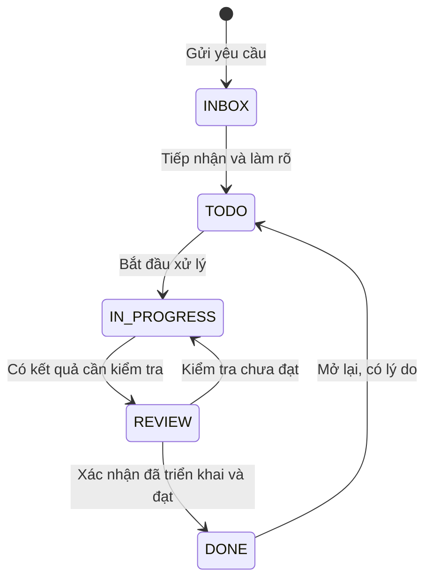

# Đặc tả — Quản lý công việc nội bộ CMS

- Ngày: 17/10/2026.
- Trạng thái: bản thiết kế đề xuất, chưa triển khai.
- Phạm vi đã xác nhận: module nội bộ trong CMS; backend ở API/shared.
- Tài liệu kỹ thuật: [TDD_QUAN_LY_CONG_VIEC_KANBAN.md](TDD_QUAN_LY_CONG_VIEC_KANBAN.md).

## 1. Mục tiêu

Có một nơi để nhân viên gửi yêu cầu tính năng, báo lỗi, trao đổi và theo dõi tiến độ. Người xử lý biết việc được giao, mức ưu tiên, hạn hoàn thành và điều kiện nghiệm thu. Người yêu cầu biết việc đã được tiếp nhận, đang xử lý hay đã hoàn tất.

V1 dùng một bảng Kanban chung, phân loại theo module CMS. Chưa cần dự án, sprint, epic, workflow tùy chỉnh hoặc đồng bộ GitHub. “Hoàn thành” là đã triển khai ở môi trường sử dụng và được xác nhận; code xong hoặc merge xong chưa đồng nghĩa hoàn thành.

## 2. Menu và màn hình

Menu cha **Công việc**, icon riêng; hai mục con **Bảng công việc**, **Việc của tôi**. Giữ Nhân sự là nhóm đầu tiên như hiện tại. Hai mục dùng cùng màn hình và nguồn dữ liệu; Việc của tôi là bộ lọc người phụ trách bằng tài khoản hiện tại.

Route chính `/tasks`; hỗ trợ hai chế độ Kanban và danh sách. Chi tiết mở modal rộng trong vùng nội dung, vẫn thấy sidebar. URL giữ bộ lọc và mã task đang mở; F5 hoặc gửi link cho đồng nghiệp mở lại đúng trạng thái.

Ví dụ: `/tasks?view=board&type=BUG&assignee=me&priority=HIGH&task=123`.

### 2.1. Bố cục Kanban

- Header gọn: tên trang, tổng số việc phù hợp bộ lọc, nút Tạo công việc.
- Một thanh lọc dùng chung phong cách CMS: tìm mã/tiêu đề; loại việc; module; người phụ trách; người tạo; ưu tiên; hạn; trạng thái. Có xóa bộ lọc.
- Lối tắt: Việc của tôi, Tôi đã tạo, Chưa phân công, Quá hạn.
- Năm cột: Tiếp nhận, Cần làm, Đang làm, Chờ kiểm tra, Hoàn thành.
- Mỗi cột có số lượng đúng theo bộ lọc, tải thêm riêng. Không tải toàn bộ lịch sử một lần.
- Card: mã, biểu tượng loại việc, tiêu đề tối đa 2 dòng, module, ưu tiên, người phụ trách, hạn, số bình luận/tệp. Hạn quá hạn có cả chữ và màu.
- Việc bị chặn hiển thị nhãn Cần hỗ trợ + lý do; không tạo thêm cột.
- Việc hủy/lưu trữ mặc định ẩn. Chọn bộ lọc tương ứng chuyển sang danh sách để xem và khôi phục.
- Kéo thả giữa cột để đổi trạng thái. V1 không kéo thả để sắp xếp tùy ý trong cột; sắp theo ưu tiên giảm dần rồi ngày tạo và ID tăng dần.
- Luôn có nút Đổi trạng thái thay cho kéo thả, dùng được bằng bàn phím và điện thoại.

### 2.2. Tạo công việc

Bắt buộc ban đầu chỉ có loại việc, tiêu đề và mô tả. Người gửi mặc định là tài khoản đăng nhập, mã sinh tự động. Ưu tiên mặc định Bình thường; người phụ trách có thể chưa chọn.

| Trường | Quy tắc |
| --- | --- |
| Loại | Tính năng mới FEATURE / Báo lỗi BUG / Cải tiến IMPROVEMENT / Công việc khác TASK |
| Tiêu đề | 5–200 ký tự sau trim |
| Mô tả | 10–20.000 ký tự, nội dung văn bản/Markdown an toàn |
| Module | Chọn module CMS hoặc Khác; không nhập mã kỹ thuật |
| Ưu tiên | Khẩn cấp / Cao / Bình thường / Thấp |
| Người phụ trách | Một tài khoản CMS đang hoạt động và có quyền tham gia xử lý |
| Hạn hoàn thành | Không bắt buộc, dd/mm/yyyy, cho phép ngày quá khứ khi nhập việc tồn |
| Trang liên quan | Đường dẫn CMS, tự điền nếu tạo từ trang đang xem; bỏ token và tham số nhạy cảm |
| Tệp/ảnh | Tối đa 10 tệp/task, 10 MB/tệp; PNG, JPEG, WebP, PDF |

Báo lỗi có vùng bổ sung: bước tái hiện, kết quả thực tế, kết quả mong đợi. Tính năng/cải tiến có vùng tiêu chí nghiệm thu. Cho phép gửi khi chưa rõ tất cả; trước khi chuyển sang Cần làm phải bổ sung đủ các mục tương ứng. TASK dùng tiêu chí hoàn thành tương tự tính năng.

Tạo task trước rồi tải tệp lên. Nếu upload lỗi, giữ task và nội dung đã lưu; hiển thị tệp lỗi để thử lại, không tạo task thứ hai.

Người gửi được đề xuất ưu tiên khi tạo; sau tiếp nhận chỉ điều phối được đổi ưu tiên/hạn/người phụ trách. Trường người phụ trách và hạn chỉ mở cho điều phối khi tạo; người gửi thường ghi nhu cầu thời gian trong mô tả. Mọi task mới bắt đầu ở Tiếp nhận, không cho client tự chọn trạng thái khởi tạo.

### 2.3. Chi tiết công việc

- Header: mã, loại, tiêu đề, trạng thái; thao tác chính rõ ràng.
- Nội dung trái: mô tả, thông tin báo lỗi hoặc tiêu chí nghiệm thu, ảnh/tệp, kết quả xử lý, bình luận và lịch sử.
- Cột phải: module, ưu tiên, người tạo, người phụ trách, hạn, thời điểm tạo/cập nhật/hoàn thành.
- Sửa thuộc tính theo quyền, không bắt người dùng đi qua nhiều màn hình.
- Kết quả xử lý ghi rõ đã sửa gì, cách kiểm tra, môi trường đã triển khai; liên kết PR/release là tùy chọn.
- ESC đóng modal; khi đang sửa chưa lưu phải hỏi bỏ thay đổi. Khi đang mở popup con, ESC đóng popup con trước.
- Bình luận theo thứ tự thời gian, hỗ trợ ảnh đính kèm ở cấp task; V1 chưa có @mention hoặc email thông báo.
- Lịch sử hiển thị người thực hiện, thời điểm, nội dung thay đổi dễ đọc; không hiển thị JSON audit thô.
- Không hiển thị khối tệp/kết quả xử lý trống; bình luận trống vẫn có ô để bắt đầu trao đổi.

## 3. Luồng xử lý

| Chuyển trạng thái | Điều kiện |
| --- | --- |
| Tiếp nhận → Cần làm | Đủ thông tin nghiệp vụ; người điều phối tiếp nhận |
| Cần làm → Đang làm | Có người phụ trách |
| Đang làm → Chờ kiểm tra | Có kết quả xử lý và hướng dẫn kiểm tra; bỏ cờ bị chặn |
| Chờ kiểm tra → Hoàn thành | Người tạo hoặc điều phối xác nhận đạt; có môi trường và ngày triển khai |
| Chờ kiểm tra → Đang làm | Ghi lý do chưa đạt |
| Hoàn thành → Cần làm | Người tạo hoặc điều phối mở lại, ghi lý do; giữ lịch sử hoàn thành cũ |
| Cần làm → Tiếp nhận; Đang làm → Cần làm | Điều phối điều chỉnh kế hoạch, bắt buộc lý do |
| Bất kỳ trạng thái chưa hoàn thành → Hủy | Điều phối hủy, ghi lý do; nếu trùng chỉ rõ task gốc |
| Hủy → Tiếp nhận | Điều phối khôi phục, ghi lý do |

Đã hoàn thành không hủy trực tiếp; mở lại trước. Không cho chuyển tắt Tiếp nhận → Hoàn thành. Task bị chặn vẫn giữ trạng thái hiện tại, cờ này chỉ áp dụng cho Cần làm/Đang làm/Chờ kiểm tra và không được hoàn thành khi chưa gỡ chặn.

Lưu trữ chỉ áp dụng cho Hoàn thành/Hủy, chỉ người điều phối; không xóa vật lý. Muốn sửa task đã lưu trữ phải khôi phục trước.

## 4. Phân quyền

V1 là bảng chung nội bộ: người có quyền xem module thấy mọi task trong bảng, bao gồm bình luận và tệp. Không dùng bảng này để chứa dữ liệu riêng tư chỉ dành cho một phòng ban; phân vùng theo dự án/nhóm là mở rộng sau.

| Quyền | Phạm vi |
| --- | --- |
| tasks.view | Xem bảng, chi tiết, lịch sử đã lọc, tải tệp |
| tasks.create | Gửi yêu cầu; sửa mô tả nghiệp vụ task mình tạo khi còn Tiếp nhận |
| tasks.update | Người được giao cập nhật kết quả, cờ chặn, chuyển Đang làm/Chờ kiểm tra của việc mình phụ trách |
| tasks.comment | Thêm bình luận/tệp; sửa hoặc ẩn bình luận của chính mình |
| tasks.manage | Điều phối: sửa nội dung/ưu tiên/hạn, giao việc, chuyển trạng thái, nghiệm thu, hủy, lưu trữ và kiểm duyệt bình luận/tệp |

Mọi quyền thao tác cần kèm tasks.view. Người tạo có tasks.create được nghiệm thu, trả lại hoặc mở lại chính task mình tạo. Điều phối có thể nghiệm thu thay. Người được giao không tự nghiệm thu trừ khi đồng thời là người tạo hoặc có tasks.manage.

Gán quyền qua roles/permissions hiện tại, không thêm hệ vai trò riêng. Migration chỉ cấp các quyền cho ADMIN; các vai trò khác do quản trị cấp theo nhu cầu. Backend kiểm tra cả quyền lẫn quan hệ người tạo/người phụ trách, không chỉ ẩn nút trên UI.

## 5. Quy tắc dữ liệu và trải nghiệm

- Dùng tài khoản CMS (`users`) làm người tạo/người phụ trách; thông tin nhân viên lấy qua liên kết `users.employee_id` nếu cần. Không tạo hồ sơ nhân sự mới.
- Không tự giao lại việc khi tài khoản bị khóa; giữ tên lịch sử, hiển thị Tài khoản ngừng hoạt động và cho điều phối giao lại.
- Thời gian hiển thị theo Asia/Ho_Chi_Minh; ngày dd/mm/yyyy, thời điểm dd/mm/yyyy HH:mm.
- Quá hạn: hạn nhỏ hơn ngày hiện tại, task chưa Hoàn thành/Hủy và chưa lưu trữ. Hôm nay chưa tính quá hạn.
- Kéo thả sai điều kiện phải mở form bổ sung hoặc giải thích cụ thể; hủy form thì card trở lại vị trí cũ.
- Hai người sửa cùng lúc: báo dữ liệu đã thay đổi và tải lại, không âm thầm ghi đè.
- Mạng lỗi khi chuyển cột: hoàn nguyên card; không báo thành công giả.
- Bộ đếm, dữ liệu danh sách và Kanban dùng cùng bộ lọc. Phân trang danh sách dùng component chung CMS.
- Nội dung không được tự thực thi HTML/script; liên kết và tệp phải kiểm tra quyền khi mở.

## 6. Tiêu chí nghiệm thu V1

1. Tạo báo lỗi/tính năng nhanh, mã duy nhất, retry gửi không sinh việc trùng.
2. F5 giữ view, bộ lọc và task đang mở; nút Back đóng chi tiết trở lại bảng.
3. Kéo thả và nút chuyển trạng thái cho kết quả giống nhau; không vượt điều kiện hoặc quyền.
4. Người tạo theo dõi được kết quả, trả lại nếu chưa đạt và mở lại khi lỗi tái diễn.
5. Người phụ trách chỉ cập nhật việc của mình; người không có quyền nhận 403, không đọc được tệp bằng URL trực tiếp.
6. Bình luận, tệp, lịch sử đúng task; không tạo bảng audit riêng.
7. Tài khoản khóa vẫn hiển thị trên việc cũ nhưng không được chọn giao việc mới.
8. UI dùng được ở desktop/mobile, cuộn từng cột, bàn phím và nút chuyển trạng thái hoạt động.
9. Trạng thái rỗng, lỗi tải, lưu thất bại và xung đột đều có hướng xử lý rõ ràng.
10. Không thay đổi nghiệp vụ lương, bán hàng, kho, vl-app hoặc vl-desktop.

## 7. Ngoài V1

Nhiều bảng/dự án, sprint, subtask/checklist, nhãn tự tạo, nhiều người phụ trách, thứ tự kéo thả trong cột, thông báo email/push, @mention, tự đồng bộ PR, tự đóng task khi deploy, SLA và báo cáo năng suất. Chỉ bổ sung khi có nhu cầu thực tế.
