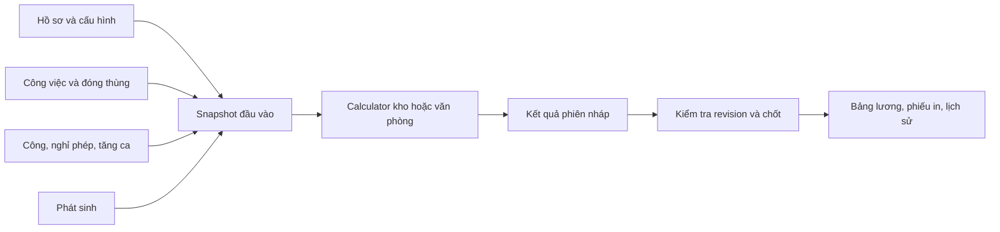

# TDD — Lương kho, lương văn phòng, nghỉ phép và ngày phép

Ngày: 16/10/2026. Phiên bản: 1.0. Trạng thái: thiết kế đề xuất để triển khai; chưa tạo schema hoặc sửa ứng dụng.

Tài liệu nghiệp vụ: [Phân tích chuyển lương kho và văn phòng](phan-tich-chuyen-luong-kho-van-phong.md).

## 1. Phạm vi và quyết định kiến trúc

Triển khai chức năng tương đương trang cũ: hồ sơ lương, Công việc/Chi tiết công việc, Đóng thùng/Chi tiết đóng thùng, công và tăng ca, phát sinh, Nghỉ phép, Ngày phép, bảng lương kho/văn phòng, chi tiết và in/xuất. Ưu tiên lương kho.

- Sản lượng nhập qua phiếu công việc/đóng thùng như cũ. Không tích hợp sổ kho, chứng từ kế toán hoặc hệ thống tồn kho trong thiết kế này.
- Module mới có namespace `staffpay`, tiền tố bảng `sp_`, API `/staff-payroll`, route `/staff-payroll`. Các tên này là đề xuất mới.
- Không gọi pipeline lương sale, không dùng các màn hình salary-setup/payroll-config/payroll-run/payroll-result/salary-adjustment, không ghi bảng `payrolls` hoặc cấu hình sale.
- Kho và văn phòng dùng chung các thành phần nội bộ module mới: phép, lịch, phát sinh, lưu phiên, audit; có calculator riêng.
- Dùng `employees.id` để liên kết định danh nhân viên sau khi mapping được xác nhận. Thông số tính lương và snapshot lưu ở `sp_`, không đọc trực tiếp các trường lương sale để tính.
- Quy trình duyệt nghỉ, khóa kỳ và nhật ký là cải tiến đề xuất để kiểm soát dữ liệu. Cách nhập/duyệt cần chốt với người vận hành, nhưng phải giữ tính nhất quán dù cùng một người có cả hai quyền.

## 2. Căn cứ kỹ thuật đã đọc

Backend mới sử dụng Java/Micronaut, entity/DAO trong `vl-shared`, controller trong `vl-api`, `ApiResponse` và JDBC đang có. Frontend `vl-cms` dùng React/TypeScript, TanStack Router/Query, React Hook Form và Zod; có ExcelJS. Dùng phiên bản dependency hiện có, không yêu cầu nâng cấp để thực hiện module.

Đã đối chiếu `Employee.java`, một controller CRUD và các model/utils lương cũ. Chưa khảo sát toàn bộ cơ chế quyền, job nền và database production; khi triển khai phải nối adapter theo convention thực tế của repo, không tự tạo cơ chế xác thực thứ hai.

Mã cũ làm chuẩn đối chiếu: `WHSalaryModel`, `WHSalaryUtils`, `WHQuantityUtils`, `WHCratingUtils`, `SalaryOfficeModel`, `SalaryOfficeUtils`, `LeaveUtils`, các entity `WhQuantity`, `WhQuantityDetail`, `WhCrating`, `WhCratingDetail`, `OnLeave`, `OnLeaveRegister`.

## 3. Thành phần và vị trí mã

```text
vl-shared/src/main/java/com/vlife/shared/
  jdbc/entity/staffpay/           Entity sp_*
  jdbc/dao/staffpay/              Truy vấn có scope kỳ/nhóm/nhân viên
  service/staffpay/
    StaffPayProfileService       Hồ sơ có hiệu lực
    StaffPayWorkService          Phiếu công việc và phân bổ
    StaffPayCratingService       Phiếu đóng thùng và phân bổ
    StaffPayCalendarService      Lịch và công theo ngày/buổi
    StaffPayOvertimeService      Giờ tăng ca duy nhất theo ca
    StaffPayLeaveService         Đơn nghỉ, duyệt, hủy
    StaffPayLeaveBalanceService  Quỹ phép và giao dịch biến động
    StaffPayInputService         Phát sinh, kiểm tra đầu vào
    StaffPayRunService           Tính, kiểm tra nguồn, chốt, mở kỳ
    WarehousePayCalculator       Tính thu nhập kho
    OfficePayCalculator          Tính thu nhập văn phòng
    StaffPayDeductionCalculator  Khấu trừ theo policy riêng
    StaffPayMigrationService     Import staging và đối soát
vl-api/src/main/java/com/vlife/api/controller/staffpay/
vl-api/src/main/resources/db/migration/  Migration schema/quyền mới
vl-cms/src/features/staff-payroll/       Feature mới
vl-cms/src/routes/_authenticated/staff-payroll/
```

Controller chịu trách nhiệm xác thực, kiểm tra quyền/scope và validate DTO; service giữ transaction và quy tắc; calculator nhận snapshot bất biến, trả breakdown, không đọc/ghi DB. Không dùng CRUD generic để bỏ qua kiểm tra trạng thái kỳ hoặc tự cập nhật bảng chi tiết sinh tự động.



## 4. Quy ước dữ liệu

- ID mới `BIGINT` cho bảng `sp_`; `employee_id` có kiểu tương thích chính xác với PK `employees` khi tạo FK. JSON API biểu diễn ID lớn và decimal dưới dạng chuỗi để tránh mất chính xác trên JS.
- Ngày nghiệp vụ `DATE`, kỳ `CHAR(7)` dạng `YYYY-MM`; timestamp audit theo convention của hệ thống, hiển thị múi giờ Asia/Ho_Chi_Minh.
- Sản lượng `DECIMAL(20,6)`, giờ `DECIMAL(8,2)`, ngày phép `DECIMAL(8,2)`, tỷ lệ `DECIMAL(12,6)`, tiền trung gian `DECIMAL(20,6)`, tiền kết quả VND `DECIMAL(20,0)`.
- Mọi bảng ghi có `created_at/by`, `updated_at/by`, `version`. Update dùng optimistic lock `WHERE id=? AND version=?`; xung đột trả lỗi, không ghi đè.
- Danh mục đã được tham chiếu chỉ ngừng hiệu lực; phiếu đã ghi nhận dùng trạng thái hủy, không hard delete. Snapshot kết quả giữ được tên/mã gốc dù danh mục đổi tên.
- Khoảng hiệu lực dùng `[effective_from, effective_to)`; không chồng khoảng trên cùng khóa nghiệp vụ. Kiểm tra trong transaction có khóa bản ghi cha.
- Tiền âm chỉ cho khoản điều chỉnh có loại và lý do. Số lượng/giờ nhập gốc phải dương; số người > 0, không trùng employee trong một phiếu.

## 5. Mô hình dữ liệu

Tên và cột dưới đây là hợp đồng thiết kế đề xuất, không phải schema đã tồn tại. DDL triển khai phải bổ sung FK/index, audit/version theo mục 4.

### 5.1. Hồ sơ, lịch và cấu hình

| Bảng | Cột nghiệp vụ chính | Ràng buộc/index |
| --- | --- | --- |
| `sp_employee_profiles` | employee_id, payroll_group `WAREHOUSE/OFFICE`, effective_from/to, employment_from/to, base_salary, salary_fund, insurance_base, dependent_count, tax_policy_id, insurance_policy_id, calendar_id, overtime_policy_id | index employee/effective; không chồng hiệu lực một nhân viên; lưu riêng với cấu hình sale |
| `sp_profile_allowances` | profile_id, code, amount, treatment `IN_DAY_BASE/ADD_GROSS/DEDUCTION_ONLY`, tax_treatment | unique profile/code; treatment theo policy, không cộng một khoản hai lần |
| `sp_calendars` | code, name, version | unique code/version |
| `sp_calendar_days` | calendar_id, work_date, morning_work, afternoon_work, day_type `NORMAL/SUNDAY/HOLIDAY` | unique calendar/date; lễ ưu tiên hơn Chủ nhật trong policy mới sau khi duyệt |
| `sp_job_categories` | code, name, rate_scope `CATEGORY/JOB`, active | unique code; thay nhánh ID=3 bằng rate_scope |
| `sp_jobs` | category_id, code, name, quantity_unit, active | unique code |
| `sp_work_rates` | category_id, job_id nullable, day_shift_type, unit, divisor, price, coefficient, effective_from/to | khóa phạm vi chuẩn hóa để job null không tạo duplicate; không chồng hiệu lực |
| `sp_crating_types` | code, name, unit, active | unique code; map ZIN/HOP từ nguồn |
| `sp_crating_rates` | type_id, price, effective_from/to | không chồng hiệu lực type |
| `sp_pay_policies` | code, version, policy_type, effective_from/to, payload_json, status | schema JSON được validate; version đã dùng bất biến |

`sp_pay_policies` giữ chính sách tăng ca, khấu trừ và làm tròn của module mới: căn cứ, hệ số, bậc tính, khoản miễn/giảm theo kỳ. Không seed mặc định thông số pháp lý từ code cũ cho kỳ mới. Seed quy tắc để đối chiếu chỉ có trạng thái DRAFT cho đến khi kế toán xác nhận.

Hồ sơ trong MVP có hiệu lực đầu tháng; nếu thay đổi thông số giữa tháng thì báo cần xử lý trước tính, không tự chọn bản cuối cùng. Ngày vào/nghỉ việc vẫn áp dụng giữa tháng. Một nhân viên đổi nhóm kho/văn phòng giữa tháng là trường hợp cần quy tắc riêng; MVP chặn chốt để tránh trả hai lần.

### 5.2. Công việc, đóng thùng và đầu vào lương

| Bảng | Cột chính | Ràng buộc/index |
| --- | --- | --- |
| `sp_work_entries` | work_date, shift_code, category_id, job_id, quantity, unit, reported_hours, note, status `DRAFT/CONFIRMED/CANCELLED` | index date/status/category |
| `sp_work_allocations` | work_entry_id, employee_id, allocated_quantity | unique entry/employee; tổng bằng quantity của phiếu |
| `sp_crating_entries` | work_date, crating_type_id, quantity, note, status | index date/status/type |
| `sp_crating_allocations` | crating_entry_id, employee_id, allocated_quantity | unique entry/employee; tổng bằng quantity |
| `sp_overtime_entries` | employee_id, work_date, shift_code, hours, source_type `WORK/MANUAL/LEGACY`, source_refs_json, day_type, status | unique employee/date/shift cho bản hiện hành; index date/status |
| `sp_attendance_adjustments` | employee_id, work_date, session `AM/PM`, payable_delta, reason, status | index employee/date; không vượt công tối đa và không trừ lặp nghỉ |
| `sp_pay_items` | employee_id, effective_date, period, kind `INCOME/DEDUCTION`, code, amount, tax_treatment, reason, status, origin_result_id nullable | index employee/period/status |

Chi tiết công việc/đóng thùng là bảng phân bổ sinh từ phiếu, không có endpoint sửa trực tiếp. Danh sách tổng hợp theo người đọc các bảng này; tính tiền tại calculator theo rate snapshot.

### 5.3. Nghỉ phép và ngày phép

| Bảng | Cột chính | Ràng buộc/index |
| --- | --- | --- |
| `sp_leave_types` | code, name, active | unique code |
| `sp_leave_policies` | type_id, effective_from/to, paid_ratio, deduct_balance, grant_mode, grant_days, allow_negative, carry_rule_json | không chồng hiệu lực; snapshot policy trên đơn đã duyệt |
| `sp_leave_requests` | employee_id, type_id, reason, status, submitted_at, approved_at/by, revision | index employee/status; lịch sử sửa giữ trong audit |
| `sp_leave_request_days` | request_id, leave_date, session `AM/PM`, days=0.5, paid_ratio, deduct_balance, policy_snapshot | unique request/date/session; index date |
| `sp_leave_reservations` | employee_id, leave_date, session, request_id | unique employee/date/session; khóa thời gian của đơn chờ duyệt/đã duyệt |
| `sp_leave_accounts` | employee_id, type_id, year, balance, version | unique employee/type/year; khóa hàng khi cấp/trừ/hoàn |
| `sp_leave_lots` | account_id, origin_type, granted_days, remaining_days, expires_on nullable, origin_key | unique origin_key; dùng khi phép có hạn sử dụng |
| `sp_leave_transactions` | account_id, lot_id, request_day_id nullable, operation, signed_days, event_key, reversal_of nullable, reason | unique event_key; giao dịch bất biến; index account/created_at |

`operation`: OPENING, GRANT, USE, REFUND, ADJUST, CARRY_IN, CARRY_OUT, EXPIRE. Balance là cache trong transaction, tổng giao dịch là căn cứ đối soát. Tách lot để biết hoàn lại phần phép đã hết hạn, tránh chỉ cộng phép trở lại mà mất hạn sử dụng.

Với chính sách không trừ quỹ, nghỉ vẫn ảnh hưởng công nhưng không ghi USE. Với nghỉ không lương, paid_ratio=0. MVP chỉ hỗ trợ paid_ratio 0 hoặc 1; tỷ lệ khác phải có thay đổi nghiệp vụ được duyệt.

### 5.4. Phiên lương, snapshot và nhật ký

| Bảng | Cột chính | Ràng buộc/index |
| --- | --- | --- |
| `sp_config_state` | id cố định, revision, updated_at/by | một hàng điều phối phiên cấu hình module |
| `sp_pay_periods` | period, payroll_group, status `OPEN/LOCKED`, input_revision, current_run_id, locked_at/by | unique period/group; hàng điều phối khóa |
| `sp_pay_runs` | period_id, sequence, status `CALCULATING/READY/STALE/FAILED/FINALIZED/SUPERSEDED`, input_revision, config_revision, fingerprint, request_key, error_summary | unique period/sequence; unique request_key |
| `sp_pay_input_snapshots` | run_id, employee_id, source_type, source_id, source_version, payload_json | index run/employee; dữ liệu bất biến sau capture |
| `sp_pay_results` | run_id, employee_id, profile_snapshot, work_days, paid_leave_days, unpaid_leave_days, gross_total, deduction_total, net_total | unique run/employee |
| `sp_pay_result_lines` | result_id, component_code, quantity, unit, base, rate, coefficient, divisor, raw_amount, rounded_amount, formula_version, source_refs_json | index result/component; lưu nguồn và diễn giải |
| `sp_pay_run_errors` | run_id, employee_id nullable, code, source_ref, message | index run/employee |
| `sp_audit_events` | actor_id, action, entity_type/id, before_json, after_json, reason, correlation_id, timestamp | append-only; index entity/timestamp |
| `sp_legacy_maps` | source_system, entity_type, legacy_id, target_id, import_batch, source_hash | unique source/entity/legacy_id |
| `sp_import_batches` | kind, status, checksum, counts_json, reconciliation_json | nhận dạng lần import và báo cáo lỗi |

Không có lệnh xóa kết quả theo kỳ để chạy lại. Chạy mới tạo sequence mới; chỉ một run được tham chiếu bởi `current_run_id` khi chốt.

## 6. Luồng ghi nhận công việc và tăng ca

### 6.1. Chia đều sản lượng

1. Validate ngày, danh mục, unit, số lượng, danh sách nhân viên và nhóm lương có hiệu lực.
2. Khóa kỳ bị ảnh hưởng và kiểm tra OPEN; sửa phiếu đổi tháng phải khóa cả kỳ cũ/mới theo thứ tự cố định.
3. Chia `quantity / N` với scale 6; phân phối phần dư từng đơn vị 0.000001 theo employee_id tăng dần để tổng chi tiết bằng tổng phiếu. Lưu thuật toán/version trong audit.
4. Ghi phiếu và thay thế chi tiết trong cùng transaction, tăng input_revision của kỳ.
5. Phiếu DRAFT chưa tham gia lương; CONFIRMED mới được tính. UI có thể “Lưu và xác nhận” cho người có quyền để phù hợp thao tác nhập hộ của kế toán.

Không cho chi tiết có nhân viên trùng, đơn vị sai hoặc người không thuộc nhóm kho. Việc hủy đánh dấu phiếu, giữ chi tiết để tra cứu, loại khỏi lần tính mới.

### 6.2. Tăng ca kho

Từ danh sách nhân viên và reported_hours trên phiếu công việc, đối chiếu `sp_overtime_entries` theo người/ngày/ca. Nhiều việc trong cùng ca không tạo thêm số giờ. Nếu chưa có thì tạo nháp; nếu đã có cùng số giờ thì liên kết thêm nguồn; nếu khác giờ thì yêu cầu xác nhận. Sửa/hủy nguồn đặt bản giờ liên quan về trạng thái cần kiểm tra; không tự xóa giờ đã được xác nhận từ nguồn khác.

Dữ liệu nhập cũ có thể không đủ để suy ra ca duy nhất; migration phải báo các ca có nhiều dòng để đối chiếu, không tự chọn MAX hoặc SUM mà không có quy tắc đã duyệt. Ca lễ ban ngày mà code cũ quy đổi 4 giờ cần được thể hiện thành dữ liệu giờ hoặc policy có version.

Tăng ca văn phòng nhập trực tiếp, dùng cùng ràng buộc thời gian và khóa kỳ. Đơn nghỉ và giờ/công cùng buổi phải được kiểm tra trước xác nhận.

## 7. Luồng nghỉ phép và số dư

### 7.1. Trạng thái và đặt chỗ

`DRAFT → SUBMITTED → APPROVED | REJECTED`; DRAFT/SUBMITTED có thể CANCELLED; APPROVED hủy bằng thao tác riêng có quyền. Đơn APPROVED không sửa tại chỗ: hủy/hoàn và tạo bản thay thế có liên kết, hoặc mở kỳ liên quan trước khi sửa nếu kỳ đã khóa.

Khi submit, chuẩn hóa thành các buổi làm việc theo lịch, bỏ buổi không làm việc và báo rõ số ngày không tính. Tạo reservations; unique key chống hai đơn chồng nhau. SUBMITTED chỉ giữ chỗ thời gian, chưa trừ balance. Reject/cancel giải phóng reservations. Chặn thay đổi lịch hồi tố có ảnh hưởng đơn đã duyệt nếu chưa có đối soát.

### 7.2. Duyệt trong transaction

1. Kiểm tra quyền, version, trạng thái SUBMITTED; khóa các kỳ lương liên quan theo thứ tự period/group.
2. Khóa các tài khoản phép theo employee/type/year tăng dần, sau đó các lot theo hạn sử dụng và ID.
3. Kiểm tra lịch, hồ sơ, trùng công/giờ, policy và số dư. Duyệt đồng thời không được vượt số dư nếu allow_negative=false.
4. Trừ các lot hết hạn sớm trước; tạo USE theo từng ngày/buổi và lot. `event_key=requestRevision/day/lot/USE` chống retry trùng.
5. Cập nhật balance, snapshot policy, trạng thái APPROVED và audit; tăng input_revision các kỳ bị ảnh hưởng rồi commit.

Đơn nhiều tháng/năm được duyệt toàn bộ hoặc rollback toàn bộ; số dư trừ vào tài khoản năm của từng ngày nghỉ. Không giữ một transaction mở trong lúc chờ người dùng.

### 7.3. Hủy và hoàn phép

Khóa cùng thứ tự như duyệt, kiểm tra chưa hủy, tạo REFUND tham chiếu USE gốc, giữ nguyên giao dịch gốc. Unique reversal/event key bảo đảm hoàn đúng một lần. Hoàn vào lot gốc; nếu lot đã hết hạn thì ghi REFUND và EXPIRE bù theo policy, không làm tăng phép đang sử dụng trái quy định. Nếu đã chuyển năm, xử lý điều chỉnh lot đích có truy vết theo quy tắc chuyển được duyệt.

Kỳ khóa chặn hủy có ảnh hưởng lương. Người có quyền mở kỳ với lý do trước, hoặc tạo điều chỉnh cho kỳ sau; API không âm thầm sửa số tiền đã chốt.

### 7.4. Cấp/chuyển phép

MVP hỗ trợ cấp theo năm và điều chỉnh có xem trước. Chuyển năm/hết hạn là batch do người có quyền kích hoạt sau khi chốt policy; chưa tự chạy scheduler khi chính sách chưa rõ. Mỗi nhân viên có khóa `employee/type/year/action/policyVersion` để retry không cấp hai lần. Chuyển ra/vào hai tài khoản thực hiện cùng transaction, dùng hai giao dịch đối ứng. Màn hình báo số đã xử lý/lỗi; retry chỉ xử lý phần chưa hoàn tất.

## 8. Công thức và hợp đồng tính lương

### 8.1. Snapshot đầu vào

Calculator nhận kỳ, hồ sơ có hiệu lực, lịch, nghỉ APPROVED, điều chỉnh công đã xác nhận, giờ tăng ca đã xác nhận, phiếu công việc/đóng thùng CONFIRMED, phát sinh và policy. Không đọc tên/giá hiện tại khi xem lại run đã lưu.

- `D`: công chuẩn toàn tháng theo lịch, phải > 0.
- `E`: công lịch trong khoảng nhân viên thực tế làm việc trong tháng.
- `L`: tổng ngày nghỉ hợp lệ thuộc lịch làm việc.
- `P`: ngày nghỉ hưởng lương thuộc L.
- `A`: điều chỉnh công đã duyệt, không trùng phần nghỉ đã tính.
- `C = E - L + P + A`: công tính lương; kiểm tra không âm/vượt giới hạn được policy cho phép.

Không tự yêu cầu nhập công hằng ngày thay cho công lịch ở MVP. Chấm công hiển thị các thành phần trên để đối chiếu; thay đổi sang trả lương theo công có mặt là thay đổi quy tắc riêng.

### 8.2. Kho

```text
Lương ngày       = base_salary / D
Lương công       = Lương ngày × C
Tiền công việc   = SUM(Sản lượng phân bổ × price × coefficient / divisor)
Tiền đóng thùng  = SUM(Số lượng phân bổ × crating_price)
Tiền tăng ca     = SUM((Lương ngày / hours_per_day) × giờ × hệ số loại ngày)
Tổng thu nhập    = Lương công + Tiền công việc + Tiền đóng thùng + Tiền tăng ca
                  + khoản ADD_GROSS + thu nhập phát sinh
Thực nhận        = Tổng thu nhập − bảo hiểm − thuế − khấu trừ phát sinh
```

Theo code cũ divisor công việc=1000; đóng thùng ZIN=400, HOP=1200; tăng ca thường dùng 8 giờ và hệ số 1,5/2/3. Đây là giá trị để lập mẫu đối chiếu, chưa tự áp dụng production. Ngoại lệ nhân viên ID 28 phải map sang profile/policy, không đưa ID cũ vào calculator.

Gom tiền công theo nhân viên, nhóm việc/công việc, loại ca/ngày, đơn giá và phiên hiệu lực trước khi làm tròn để gần cấp tổng hợp cũ. Giá đổi giữa kỳ phải tách nhóm. Không giữ lỗi cộng double vào int; báo riêng chênh lệch do sửa phần lẻ.

### 8.3. Văn phòng

```text
Căn cứ lương ngày = base_salary + salary_fund + phụ cấp IN_DAY_BASE
Lương công       = (Căn cứ lương ngày / D) × C
Căn cứ OT ngày   = insurance_base / D       [theo luồng gọi cũ]
Tiền tăng ca     = SUM((Căn cứ OT ngày / hours_per_day) × giờ × hệ số)
Tổng thu nhập    = Lương công + Tiền tăng ca + khoản ADD_GROSS + phát sinh tăng
Thực nhận        = Tổng thu nhập − bảo hiểm − thuế − phát sinh giảm
```

Phụ cấp ăn/đồng phục/điện thoại thuộc căn cứ lương ngày theo code cũ; phụ cấp khác được cộng vào phát sinh. Phải mapping từng khoản, không dùng một tổng allowance vừa trong căn cứ vừa cộng lại gross. Công thức khấu trừ kho và văn phòng có khác biệt trong code cũ; dùng policy theo nhóm, không mặc định gộp chúng.

### 8.4. Khấu trừ, làm tròn và lỗi

Policy phải biểu diễn căn cứ bảo hiểm, tỷ lệ, khoản miễn/giảm và bậc thuế áp dụng cho kỳ/nhóm. Kế toán duyệt dữ liệu cấu hình và mẫu trước vận hành; tài liệu không cung cấp bảng mức pháp lý hiện hành. Không suy ra chính sách thuế chỉ từ việc có/không có insurance_base khi chưa xác nhận.

Tiền trung gian dùng BigDecimal; policy lưu `rounding_mode`, `rounding_scale`, `rounding_stage`. Đề xuất tiền VND cuối khoản làm tròn 0 chữ số; chế độ chính xác phải được đối chiếu với `NumberUtils` cũ trước seed. Tổng gross/net cộng từ khoản đã làm tròn để phiếu in khớp, đồng thời lưu raw_amount giải thích sai khác.

Các lỗi chặn READY/chốt: thiếu profile/policy/rate, hiệu lực chồng nhau, divisor hoặc D bằng 0, thiếu mapping nhân viên, giờ ca mâu thuẫn, nghỉ trùng, dữ liệu nhập chưa hợp lệ, đổi nhóm giữa kỳ chưa được hỗ trợ. Không tự thay lỗi bằng giá trị 0.

## 9. Phiên tính, sửa đầu vào và khóa kỳ

1. Mọi ghi đầu vào phải khóa hàng `sp_pay_periods` liên quan, kiểm tra OPEN và tăng input_revision trong cùng transaction. Giao dịch nhiều kỳ khóa thứ tự period/group để giảm deadlock.
2. Thay đổi cấu hình dùng một hàng điều phối config revision riêng của module (triển khai bằng bảng `sp_config_state` có một row). Ghi cấu hình khóa hàng này rồi các kỳ bị ảnh hưởng, tăng revision và đánh dấu run nháp STALE. Kỳ đã khóa không cho sửa cấu hình hồi tố; tạo version tương lai hoặc mở kỳ có kiểm soát.
3. Tạo run: transaction ngắn khóa config state rồi kỳ, capture toàn bộ input/policy snapshot và revision; tạo CALCULATING, commit. Tính từ snapshot ngoài transaction dài.
4. Hoàn tất: ghi kết quả/error, so revision hiện tại. Không đổi → READY nếu không lỗi; đã đổi → STALE; exception → FAILED. Snapshot và lỗi giữ lại để xử lý.
5. Chốt: khóa config state và kỳ, kiểm tra run READY, revision còn khớp, không có run tính dở hoặc lỗi; chuyển FINALIZED, set current_run_id, khóa kỳ trong cùng transaction.
6. Mở kỳ: quyền riêng + lý do, giữ phiên FINALIZED cũ để xem; kỳ trở lại OPEN. Khi chốt phiên thay thế, phiên cũ thành SUPERSEDED và có liên kết thay thế, không xóa.
7. Điều chỉnh kỳ sau lưu nguồn result_id/khoản bị điều chỉnh và lý do. Chỉ tính khoản chênh lệch, không nhập lại toàn bộ lương cũ.

Tác vụ tính có thể chạy đồng bộ ở MVP nếu kích thước dữ liệu phù hợp; ghi nhận run trước tính để retry theo request_key. Nếu chuyển sang job nền phải dùng cơ chế job bền vững của hệ thống hoặc thiết kế outbox riêng, không dùng thread trong bộ nhớ rồi trả thành công. Run CALCULATING quá hạn được đánh FAILED bởi tác vụ phục hồi có audit, không tự coi là hoàn tất.

## 10. API đề xuất

Tiền tố `/staff-payroll`. Danh sách có paging/filter/sort theo convention hiện tại; response bọc `ApiResponse`. Body ghi có `expected_version`; thao tác tạo/chốt/import có `request_key`. Endpoint phân quyền backend và kiểm tra nhân viên thuộc phạm vi truy cập.

| Method / path | Chức năng |
| --- | --- |
| GET/POST `/profiles`; GET/PUT `/profiles/{id}` | Hồ sơ lương và phiên hiệu lực |
| GET/POST/PUT `/job-categories`, `/jobs`, `/work-rates`, `/crating-types`, `/crating-rates`, `/policies` | Danh mục/cấu hình; PUT dùng `/{id}` |
| GET/POST `/work-entries`; GET/PUT `/work-entries/{id}` | Phiếu công việc |
| POST `/work-entries/{id}/confirm`, `/cancel` | Xác nhận/hủy, kiểm tra kỳ |
| GET `/work-details` | Chi tiết phân bổ, lọc employee/date/job |
| GET/POST `/crating-entries`; GET/PUT `/crating-entries/{id}` | Phiếu đóng thùng |
| POST `/crating-entries/{id}/confirm`, `/cancel`; GET `/crating-details` | Trạng thái và chi tiết đóng thùng |
| GET `/attendance`; POST `/attendance-adjustments` | Bảng công tổng hợp và điều chỉnh |
| GET/POST `/overtime-entries`, `/pay-items`; PUT `/{resource}/{id}` | Tăng ca/phát sinh |
| POST `/overtime-entries/{id}/confirm`, `/cancel`; tương tự `/pay-items` | Chỉ dữ liệu xác nhận tham gia lương |
| GET/POST `/leave-types`, `/leave-policies`; PUT theo id | Danh mục/chính sách phép |
| GET/POST `/leave-requests`; GET/PUT `/leave-requests/{id}` | Danh sách, tạo, sửa nháp |
| POST `/leave-requests/{id}/submit`, `/approve`, `/reject`, `/cancel` | Chuyển trạng thái nghỉ |
| GET `/leave-balances`, `/leave-balances/{id}/transactions` | Ngày phép và biến động |
| POST `/leave-grants/preview`, `/leave-grants/apply` | Xem trước/cấp phép hàng loạt |
| POST `/leave-adjustments`, `/leave-carryovers/preview`, `/leave-carryovers/apply` | Điều chỉnh/chuyển phép |
| GET `/periods`; POST `/runs` | Danh sách kỳ, tạo phiên tính với period/group |
| GET `/runs/{id}`, `/runs/{id}/errors`, `/runs/{id}/results` | Tiến trình, lỗi, bảng kết quả |
| GET `/runs/{id}/results/{employeeId}` | Snapshot và breakdown từng người |
| POST `/runs/{id}/finalize`; POST `/periods/{id}/reopen` | Chốt/mở kỳ |
| GET `/reports/year`, `/runs/{id}/export`, `/runs/{id}/payslips/{employeeId}` | Bảng năm, xuất và phiếu in theo run |
| POST `/imports/preview`, `/imports/{id}/apply`; GET `/imports/{id}` | Import và báo cáo đối soát |

Danh mục/lịch bổ sung API GET/POST `/calendars`, PUT `/calendars/{id}`, PUT `/calendars/{id}/days`; mọi chỉnh lịch phải kiểm tra ảnh hưởng công/nghỉ theo mục 7. Quyền không cho phép thay trạng thái bằng PUT generic.

Ví dụ tạo phiếu công việc:

```json
{
  "work_date": "2026-10-01",
  "shift_code": "EVENING",
  "category_id": "12",
  "job_id": "35",
  "quantity": "1000.000000",
  "unit": "KG",
  "reported_hours": "2.00",
  "employee_ids": ["101", "102"],
  "note": "Ca tối",
  "request_key": "uuid-do-client-tao"
}
```

Mã lỗi nghiệp vụ ổn định: PERIOD_LOCKED, VERSION_CONFLICT, LEAVE_OVERLAP, INSUFFICIENT_LEAVE, MISSING_RATE, AMBIGUOUS_OVERTIME, STALE_RUN, INVALID_PROFILE, POLICY_NOT_APPROVED. Dùng HTTP/ApiResponse theo convention repo, không trả thành công kèm số tiền 0 để che lỗi.

## 11. Frontend và quyền

Menu **Lương kho và văn phòng**:

| Route tương đối | Nội dung |
| --- | --- |
| `employees` | Nhân viên và hồ sơ lương riêng |
| `work`, `work-details` | Công việc, Chi tiết công việc |
| `crating`, `crating-details` | Đóng thùng, Chi tiết đóng thùng |
| `attendance`, `overtime`, `pay-items` | Công, Tăng ca, Chi phí/phát sinh |
| `leave-requests`, `leave-balances` | Nghỉ phép, Ngày phép |
| `settings` | Danh mục, đơn giá/hệ số, lịch, chính sách |
| `warehouse`, `office` | Bảng lương tháng/năm và danh sách phiên |
| `runs/$runId/employees/$employeeId` | Chi tiết và phiếu lương |
| `imports` | Xem trước, lỗi và đối soát chuyển dữ liệu |

Dùng query key bắt đầu `staff-payroll`; invalidate đúng kỳ/nhân viên sau ghi. Decimal từ API giữ dạng chuỗi, dùng decimal.js-light khi cần hiển thị phân bổ thử; backend là nguồn kết quả chính thức. UI hiển thị trạng thái kỳ/run và cảnh báo dữ liệu đã thay đổi; nút chốt chỉ bật khi READY, backend vẫn kiểm tra lại.

Bảng lương kho/văn phòng tách màn hình và bộ cột phù hợp. Phiếu in/xuất lấy run_id bất biến, gắn nhãn nháp nếu chưa FINALIZED; tổng năm lấy đúng phiên chốt hiện hành của từng kỳ, không cộng mọi run. Lịch sử SUPERSEDED chỉ xem khi chọn rõ phiên.

Quyền đề xuất: `staffpay.profile.view/manage`, `work.view/manage/confirm`, `crating.view/manage/confirm`, `attendance.manage`, `overtime.manage/confirm`, `payitem.manage/confirm`, `leave.view/manage/approve`, `leave.balance.view/manage`, `config.manage`, `payroll.view/calculate/finalize/reopen/export`, `migration.manage` (đều cùng prefix `staffpay.`). Phạm vi nhân viên/nhóm áp dụng cả list/detail/export; quyền xem công không tự cấp quyền xem tiền lương. Ánh xạ các mã này vào hệ quyền hiện có khi triển khai.

## 12. Chuyển dữ liệu

| Nguồn cũ | Đích/chiến lược |
| --- | --- |
| Staff nhóm 2/3 | Mapping employees + sp_employee_profiles và allowance snapshot |
| WhJobCategory/WhJob/WhCoefficient | Danh mục và rate có mã ổn định; không dùng nhánh ID cũ |
| WhQuantity/WhQuantityDetail | Phiếu và chi tiết; ưu tiên giữ chi tiết gốc để đối chiếu, báo nếu tổng lệch |
| WhCrating/WhCratingDetail | Phiếu và chi tiết đóng thùng |
| OnLeave/OnLeaveType | Loại, số dư/cấp phép theo năm |
| OnLeaveRegister | Đơn nghỉ theo ngày/buổi, cờ paid; xác nhận chính sách trạng thái import |
| Overtime/ConstsIncurred | Tăng ca/phát sinh; rà soát các dòng công việc kho trùng ca |
| WhSalary/SalaryOffice | Phiên lịch sử, result và snapshot theo số gốc, không tính lại |

Các tên trên là entity; phải đọc DAO/schema nguồn để xác nhận tên bảng, kiểu dữ liệu trước viết script SQL.

Quy trình: export chỉ đọc → staging → map → preview lỗi/chênh lệch → apply theo batch → reconcile. Unique legacy map và source_hash bảo đảm chạy lại không nhân dữ liệu. Dữ liệu cũ thay đổi sau preview phải preview lại; không ghi đè target đã vận hành.

Quỹ phép chọn một phương án: OPENING tại ngày chuyển hoặc dựng đầy đủ giao dịch từ lịch sử. Lịch sử trước OPENING chỉ tra cứu, có cờ không ảnh hưởng số dư; không duyệt lại để trừ phép. Các khoản chuyển năm đã nằm trong opening không cộng thêm. Đối soát theo nhân viên/loại/năm.

Run lịch sử gắn `origin=LEGACY` (bổ sung vào sp_pay_runs), lưu breakdown chỉ ở mức dữ liệu cũ có, ghi rõ phần không có nguồn chi tiết. Không dựng giả dữ liệu để khớp tổng. Kết quả chuyển không phụ thuộc policy hiện tại.

Rollback import chỉ cho batch chưa phát sinh tham chiếu vận hành, thao tác có audit. Sau vận hành dùng giao dịch đảo/điều chỉnh; không xóa hàng loạt kết quả đang được dùng. Trước cutover sao lưu và thử restore, thống nhất ngày ngừng nhập, chuyển delta cuối cùng, đối soát rồi chuyển nguồn chính.

## 13. Kiểm thử và nghiệm thu kỹ thuật

| Nhóm | Ca bắt buộc và kỳ vọng |
| --- | --- |
| Chia sản lượng | 1.000 chia 3 giữ tổng chính xác; sửa danh sách người thay toàn bộ phân bổ; retry không trùng |
| Tiền công | Đổi rate giữa tháng tách nhóm; thiếu rate báo lỗi; so sánh cắt/làm tròn cũ với policy mới |
| Đóng thùng | Hai loại có đơn giá khác; chia nhiều người; hủy phiếu loại đúng khoản |
| Công lịch | Tháng 2, lễ trùng Chủ nhật, vào/nghỉ giữa tháng, qua năm; không chia D=0 |
| Tăng ca | Một người nhiều việc cùng ca không nhân giờ; số giờ mâu thuẫn báo lỗi; văn phòng dùng đúng căn cứ OT |
| Phép | Nghỉ 0,5/1 ngày, qua tháng/năm, nghỉ hưởng lương không trừ quỹ, nghỉ không lương; không trừ ngày ngoài lịch |
| Đồng thời phép | Hai submit chồng buổi bị chặn; hai approve không vượt balance; retry approve/cancel không cộng trừ lặp |
| Hạn phép | Hoàn lot hết hạn, chuyển năm rồi hủy nghỉ cũ, retry cấp/chuyển không nhân số dư |
| Kỳ lương | Sửa nguồn khi đang tính tạo STALE; chốt đồng thời sửa nguồn chỉ một phía thành công; run FAILED không được chốt |
| Lịch sử | Reopen giữ phiên cũ, chốt mới thay current pointer, bảng năm không đếm đôi |
| Độc lập sale | Seed dữ liệu sale, chạy đầy đủ kho/văn phòng rồi so sánh dữ liệu sale không đổi |
| Phân quyền | Gọi trực tiếp API chốt/mở/import, xem lương người ngoài scope, export không có quyền đều bị chặn |
| Migration | Chạy hai lần cùng batch không đổi tổng; opening không bị trừ lịch sử; thiếu mapping báo lỗi |
| End-to-end | Nhập việc/đóng thùng → phép/phát sinh → tính → đối chiếu → chốt → in/xuất đúng snapshot |

Calculator dùng unit test với fixture số liệu đã được kế toán duyệt. Transaction/race/unique/rollback cần integration test trên cùng hệ DB với production, không dùng mock để kết luận đúng concurrency. UI chạy build/typecheck và kiểm tra các luồng chính; không cần mở rộng test sang nghiệp vụ sale ngoài kiểm chứng tính độc lập.

## 14. Kế hoạch triển khai

1. Chốt fixture kỳ mẫu và mapping, tạo migration sp_, quyền và khung route/API.
2. Hồ sơ/cấu hình + công việc/chi tiết + đóng thùng/chi tiết + calculator kho để demo.
3. Nghỉ phép/ngày phép, lịch/công, tăng ca/phát sinh, snapshot/khóa kỳ và in/xuất; hoàn tất kho.
4. Calculator và giao diện văn phòng, đối chiếu công thức từng khoản.
5. Import staging/lịch sử/số dư phép, kiểm thử cạnh tranh và quyền, đối soát kỳ thực tế.
6. Cutover theo kế hoạch BA, giữ phương án quay lại; tắt dịch vụ cũ chỉ sau nghiệm thu và kiểm kê nghiệp vụ còn phụ thuộc.

Điểm cần xác nhận trước cấu hình production: đơn giá/đơn vị, chế độ làm tròn, ngoại lệ thủ kho, giờ tăng ca trùng, chính sách thuế/bảo hiểm, định mức và chuyển phép, kỳ lịch sử và mẫu đối chiếu. Có thể triển khai khung dữ liệu/UI theo thiết kế trong khi hoàn thiện các fixture này; chưa chốt thông số không đồng nghĩa được tự dùng hằng số cũ.
