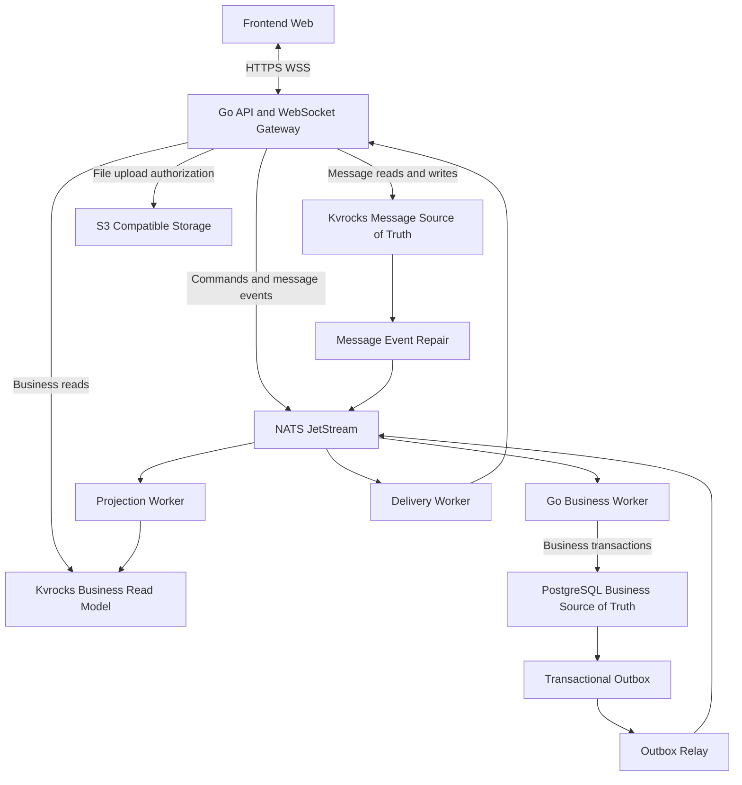
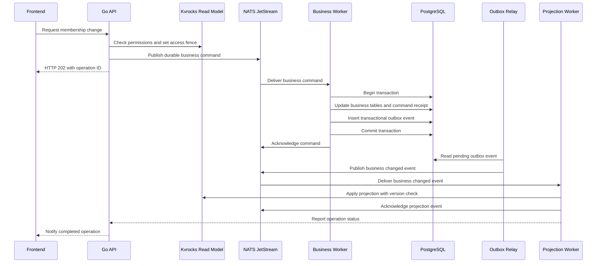
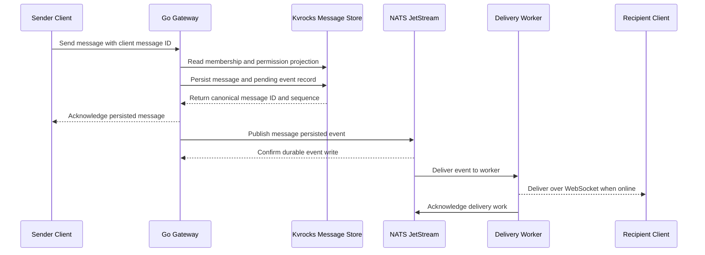
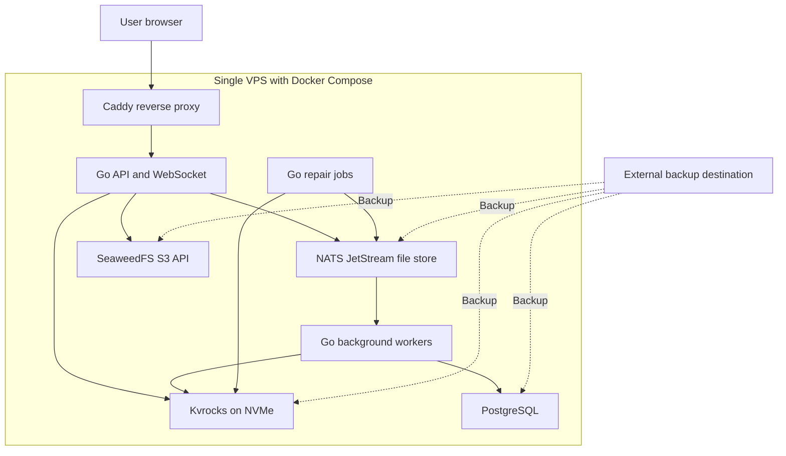

# TDD FINAL — ENTERPRISE CHAT NỘI BỘ (100–150 NHÂN VIÊN)

**Phiên bản:** 3.0 FINAL (baseline thiết kế)  
**Ngày:** 15/10/2026  
**Ngôn ngữ:** Tiếng Việt  
**Backend:** Go · **Triển khai:** Modular Monolith + Worker, Docker Compose, một VPS giai đoạn đầu  
**Kiến trúc chốt:** **Go + Kvrocks + NATS JetStream + PostgreSQL + S3-compatible storage**  
**Trạng thái:** Đặc tả sẵn sàng để bắt đầu lập trình và kiểm thử; **không có nghĩa đã chứng nhận production**. Các giả định phụ thuộc phiên bản phải kiểm chứng bằng integration/fault-injection test.

> **Đây là bản hợp nhất thay cho v2.1/v2.2/v2.3.** Không dùng ScyllaDB, Redis, Kafka, OpenSearch hoặc Kubernetes trong MVP. **NATS JetStream được GIỮ LẠI**; không thay bằng Kvrocks Streams. PostgreSQL chỉ là nguồn sự thật nghiệp vụ và không được nằm trên FE → BE request path. Kvrocks là **Message Source of Truth** đồng thời là **Business Read Model** tái tạo được.

---

## 1. Bài toán theo First Principles

Xây chat nội bộ cho **100–150 nhân viên**: chat trực tiếp, nhóm, file, gửi/nhận tức thời, lịch sử, reconnect, đã đọc, quản trị thành viên. Hệ thống cần đúng các bất biến:

1. **Ai được làm gì?** Mỗi request phải có identity và kiểm tra thành viên/quyền theo trạng thái đủ mới.
2. **Tin nhắn tồn tại?** Chỉ trả `persisted` sau khi thao tác ghi **Kvrocks (Message SoT)** hoàn tất theo durability policy đã kiểm thử.
3. **Realtime không phải lưu trữ.** NATS/WebSocket có thể gián đoạn; client phải tải bù qua API từ Kvrocks.
4. **Không gửi trùng logic.** Retry của client/worker không tạo duplicate logical message hoặc duplicate business change.
5. **Mất mạng có thể hồi phục.** Tất cả luồng quan trọng có checkpoint, retry, deduplication và reconciliation.
6. **Hạ tầng gọn.** Một VPS trước; không phát triển phân tán để giải quyết vấn đề chưa xuất hiện.

### 1.1 Phạm vi

**MVP:** OIDC login, directory user, chat 1:1 và nhóm, tạo/đổi tên nhóm, thêm/xóa thành viên, gửi/sửa/thu hồi message, phân trang lịch sử, chỉ báo đã đọc, reconnect/resync, file qua S3, audit quyền, OpenTelemetry và backup/restore.

**Ngoài MVP:** E2EE, video call, screen sharing, AI assistant, full-text search toàn cục, mobile push, native mobile, multi-tenant SaaS, multi-region HA, retention pháp lý. Thiết kế đủ điểm mở rộng, chưa triển khai.

### 1.2 Giả định tải để benchmark, không phải bảo đảm

| Tham số | Giá trị giả định |
|---|---:|
| Nhân viên đăng ký | 150 |
| Kết nối WS đồng thời (nhiều tab) | 150–250 |
| Tin nhắn/ngày | 2.000–10.000 |
| Burst mục tiêu kiểm thử | 20–50 message/s |
| Kích thước body text tối đa | 16 KiB (cấu hình được) |
| Trang lịch sử | 20–50 message/request |
| Latency mục tiêu nội vùng | p95 gửi → nhận online < 300 ms (đo, không cam kết) |
| Duy trì lịch sử | Mặc định không TTL; chính sách lưu 1–3 năm tùy doanh nghiệp |

---

## 2. ADR-001: Quyền sở hữu dữ liệu và ranh giới truy vấn

| Dữ liệu | Source of Truth | Đọc FE → Go | Ghi |
|---|---|---|---|
| User, tổ chức, nhóm, membership, permission, read cursor nghiệp vụ | **PostgreSQL** | **Kvrocks projection**; cấm query PostgreSQL | Go → **NATS command** → Business Worker → PostgreSQL |
| Message body, edit/delete, history, client idempotency | **Kvrocks** | **Kvrocks trực tiếp** qua Go | Go → **Kvrocks** trực tiếp |
| Event delivery, command transport, retry | **NATS JetStream** | Không phải DB để đọc lịch sử | Publish sau ghi SoT; worker tiêu thụ |
| Presence, typing | Go memory, tín hiệu NATS (ephemeral) | Go/NATS | TTL tự hết; không lưu bền lâu |
| Attachment bytes | **S3-compatible storage** | Pre-signed URL + auth qua Go | Upload trực tiếp S3 qua URL ngắn hạn |

**Quy tắc không thể phá vỡ:**

- Frontend chỉ giao tiếp với Go qua HTTPS/WSS. Không cấp DB credential, NATS credential cho browser.
- Binary `api` và `gateway` **không có DSN PostgreSQL** và không import repository PostgreSQL.
- PostgreSQL chỉ nằm trong `business-worker`, `projection-bootstrap`, `outbox-relay`, maintenance jobs chạy ngoài request path.
- **Không được xóa Kvrocks như xóa cache**: message gốc sẽ mất. Chỉ **business projection** được rebuild từ PostgreSQL.
- NATS ACK ≠ message persisted; WS delivered ≠ read; HTTP `202` ≠ business command đã commit.
- Không có ACID transaction xuyên PostgreSQL–Kvrocks–NATS. Phải dùng idempotency, outbox và repair.

## 3. Kiến trúc logic



**Chú ý:** `BR` và `MSG` đều là **namespace logic của cùng một Kvrocks instance** trên MVP; **không** triển khai 2 cụm database. Có thể tách instance khi cần cô lập tài nguyên.

### 3.1 Tổ chức Go source

```text
cmd/
  server/                # API + WS (không có PG DSN)
  business-worker/       # NATS command -> PostgreSQL
  outbox-relay/          # PG outbox -> NATS
  projection-worker/     # NATS -> Kvrocks read model
  projection-bootstrap/  # full rebuild từ PostgreSQL
  delivery-worker/       # NATS -> WS
  message-repair/        # Kvrocks outbox -> NATS
internal/
  identity/              # JWT/OIDC validation
  authorization/         # Kvrocks access guard, deny fence
  organization/
  conversation/
  membership/
  message/               # Kvrocks message store
  realtime/              # WS hub, sessions, backpressure
  attachment/
  projection/            # Kvrocks schema và versioning
  transport/             # HTTP, WS, NATS contract
  platform/              # config, otel, tracing, errors
migrations/postgres/
configs/
deploy/compose/
tests/integration/
tests/fault/
docs/adr/
```

Mỗi domain định nghĩa interface của storage/producer tại domain; các adapter nằm ở hạ tầng. Không dùng package `common` chứa business logic tùy tiện. Không dùng global DB client, magic retries, `panic` khi lỗi vận hành.

---

## 4. PostgreSQL — Business Source of Truth, chỉ worker truy cập

### 4.1 Dữ liệu gốc

```sql
CREATE TABLE organizations (
  id UUID PRIMARY KEY,
  name TEXT NOT NULL,
  version BIGINT NOT NULL DEFAULT 1,
  created_at TIMESTAMPTZ NOT NULL DEFAULT now()
);

CREATE TABLE users (
  id UUID PRIMARY KEY,
  organization_id UUID NOT NULL REFERENCES organizations(id),
  external_subject TEXT NOT NULL,
  display_name TEXT NOT NULL,
  status TEXT NOT NULL CHECK (status IN ('active','disabled')),
  version BIGINT NOT NULL DEFAULT 1,
  created_at TIMESTAMPTZ NOT NULL DEFAULT now(),
  UNIQUE (organization_id, external_subject)
);

CREATE TABLE conversations (
  id UUID PRIMARY KEY,
  organization_id UUID NOT NULL REFERENCES organizations(id),
  type TEXT NOT NULL CHECK (type IN ('direct','group')),
  title TEXT,
  version BIGINT NOT NULL DEFAULT 1,
  created_by UUID NOT NULL REFERENCES users(id),
  created_at TIMESTAMPTZ NOT NULL DEFAULT now()
);

CREATE TABLE conversation_members (
  conversation_id UUID NOT NULL REFERENCES conversations(id),
  user_id UUID NOT NULL REFERENCES users(id),
  role TEXT NOT NULL CHECK (role IN ('owner','admin','member')),
  state TEXT NOT NULL CHECK (state IN ('active','removed')),
  version BIGINT NOT NULL DEFAULT 1,
  last_read_seq BIGINT NOT NULL DEFAULT 0,
  updated_at TIMESTAMPTZ NOT NULL DEFAULT now(),
  PRIMARY KEY (conversation_id, user_id)
);

CREATE TABLE processed_commands (
  command_id UUID PRIMARY KEY,
  command_type TEXT NOT NULL,
  result_json JSONB NOT NULL,
  processed_at TIMESTAMPTZ NOT NULL DEFAULT now()
);

CREATE TABLE business_outbox (
  id UUID PRIMARY KEY,
  aggregate_id UUID NOT NULL,
  aggregate_version BIGINT NOT NULL,
  event_type TEXT NOT NULL,
  event_json JSONB NOT NULL,
  created_at TIMESTAMPTZ NOT NULL DEFAULT now(),
  published_at TIMESTAMPTZ,
  attempts INT NOT NULL DEFAULT 0
);
CREATE INDEX idx_business_outbox_pending ON business_outbox (created_at)
WHERE published_at IS NULL;
```

**Quy tắc transaction:** worker nhận command từ JetStream → bắt đầu SQL transaction → kiểm `processed_commands`/business invariants → mutate bảng chính và tăng version → insert `business_outbox` **cùng transaction** → commit → ACK NATS. Nếu redelivery, trả kết quả cũ, **không mutate hai lần**. Tránh race idempotency bằng `INSERT ... ON CONFLICT` cùng transaction/khóa đúng; không dùng check-then-insert ngoài transaction.

**Outbox relay:** `SELECT ... FOR UPDATE SKIP LOCKED`, publish JetStream với stable `Nats-Msg-Id` = outbox ID, **chỉ đánh dấu `published_at` sau PubAck**. Sự kiện có thể bị gửi trùng, projection bắt buộc idempotent. Không giữ SQL transaction đang khóa hàng trong suốt thời gian chờ publish mạng; dùng lease/claim hoặc retry state có timeout, có test race.

---

## 5. Kvrocks — Business Read Model (PostgreSQL mới là SoT)

### 5.1 Key schema có version

```text
biz:v1:user:{user_id}                    HASH  id, org_id, name, status, version
biz:v1:conversation:{conversation_id}    HASH  id, org_id, type, title, version
biz:v1:members:{conversation_id}         SET   active user_id
biz:v1:member:{conversation_id}:{uid}    HASH  role, state, version
biz:v1:user-conversations:{uid}          ZSET  conversation_id by last activity score
biz:v1:projection:watermark              HASH  source, global version/checkpoint
biz:v1:access-fence:{conversation_id}    STRING deny/blocked + operation_id (không TTL mù)
```

Tất cả key phải có organization guard. Key prefix chứa `v1` để hỗ trợ migration và rebuild song song. Không dùng `KEYS *` trong hot path, không trả toàn bộ membership nếu nhóm lớn. Projection không chứa credential hoặc dữ liệu vượt quyền.

### 5.2 Luồng đọc nghiệp vụ

```text
FE GET /conversations
  → Go verify JWT
  → Kvrocks projection + membership guard + version/fence
  → response
```

**Cấm fallback PostgreSQL trong API**. Nếu projection chưa ready/không bảo đảm authorization freshness → `503 READ_MODEL_NOT_READY` hoặc `403 ACCESS_DENIED` theo ngữ cảnh, tuyệt đối không default allow.

### 5.3 Luồng mutation nghiệp vụ



- `202` = command vào broker, **không** phải nghiệp vụ hoàn tất. Trả `operation_id`, có `GET /operations/{id}` (đọc từ Kvrocks projection).
- Nếu NATS PubAck thất bại, không trả `202`; nếu trạng thái publish mơ hồ, client retry cùng `command_id`.
- Một thay đổi nhiều key của projection cần áp dụng cùng thế hệ/snapshot, tránh lộ trạng thái nửa chừng. Dùng version per aggregate, staged generation + atomic pointer switch, hoặc Lua đã test atomicity trong Kvrocks.
- Sự kiện trùng/out of order: không apply nếu `version <= currentVersion`; phát hiện gap `version > current+1` → mark stale, fetch/rebuild.

### 5.4 Thu hồi quyền an toàn (bắt buộc)

Eventual consistency **không đủ** để bảo vệ chat. Quy tắc:

1. Ngay khi tiếp nhận command xóa thành viên/disable user, đặt **deny fence** trong Kvrocks **trước** khi coi operation là accepted; từ điểm đó gateway từ chối send/read liên quan cho đến khi cập nhật quyền đã được xác nhận.
2. Nếu publish command thất bại/unknown, fence vẫn deny cho đến khi reconcile; không tự động mở vì timeout.
3. Business worker commit PostgreSQL; projection nhận version mới; xác nhận read model fully updated trước khi xóa/đổi fence.
4. Gateway kiểm fence trên **mỗi** send/history/download, không chỉ lúc WS connect. Đẩy sự kiện force-disconnect/revalidate đến session liên quan.
5. Nếu Kvrocks, projection hoặc phiên bản quyền không xác thực được → **fail closed**; không cho phép người đã mất quyền đọc tin mới.
6. Cần thiết kế race test: revoke song song send, reconnect, nhiều tab, worker crash, event trễ. Revoke được coi **completed** chỉ sau barrier/projection đã có hiệu lực; trước đó có thể trả `pending`.

**Giới hạn:** Đây là giao thức ứng dụng cần formalize và test. Không tuyên bố thu hồi tức thì tại thời điểm người dùng bấm nút, mà định nghĩa mốc fence là điểm chặn. Không dùng local permission cache kéo dài vượt barrier.

### 5.5 Rebuild read model

- `projection-bootstrap` kết nối PostgreSQL bằng tài khoản read-only, chụp snapshot nhất quán của dữ liệu nghiệp vụ.
- Ghi KV theo namespace generation mới (`biz:g{N}:...`), không đụng message namespace.
- Replay outbox theo checkpoint từ snapshot; kiểm version và tổ chức.
- Chuyển active-generation **sau khi projection sẵn sàng và không có gap**; trong quá trình chưa ready phải fail-closed.
- Diễn tập wipe **chỉ projection namespace**, tuyệt đối không `FLUSHALL` làm mất message SoT.

---

## 6. Kvrocks — Message Source of Truth

### 6.1 Tổ chức dữ liệu message

```text
msg:v1:item:{message_id}                      HASH: org, conv, sender, seq, body, kind, state, version, created_at
msg:v1:conversation:{conversation_id}:timeline ZSET: member = message_id, score = seq
msg:v1:conversation:{conversation_id}:seq      STRING: counter tăng dần
msg:v1:dedup:{sender_id}:{client_message_id}   STRING: canonical message_id (không TTL ngắn)
msg:v1:event-outbox:{event_id}                 HASH: message_id, conv, type, created_at, state, attempts
msg:v1:event-pending                          ZSET: event_id theo thời điểm retry/checkpoint
```

**Không dùng thời gian làm ordering duy nhất.** `seq` tăng theo conversation và dùng làm ZSET score; vì ZSET score là double, phải có giới hạn `seq < 2^53` và kiểm thử. Không xài một ZSET toàn hệ thống; retention/archival theo conversation hoặc time bucket khi lớn. Key chứa ID không đoán được và chỉ API đã xác thực mới đọc.

### 6.2 Ghi message (đường nóng)



**Đường ghi nguyên tử (đòi hỏi test kỹ):** tạo một thao tác server-side có điều kiện (`EVAL`/`MULTI/EXEC` với guard phù hợp), thực hiện **toàn bộ**: kiểm `client_message_id` đã tồn tại → nếu có trả lại canonical ID; nếu chưa có, cấp `seq`, ghi item, ZADD timeline, ghi outbox-marker **trong cùng boundary được phiên bản Kvrocks cam kết**. Cần xác minh hỗ trợ command và atomic crash semantics trên **phiên bản Kvrocks được pin**; không giả định script Redis bất kỳ tự động bảo đảm ACID fsync ở Kvrocks.

**ACK policy:** chỉ xác nhận sau khi Kvrocks trả kết quả ghi thành công; để có mức chống mất dữ liệu khi mất điện, bật WAL và kiểm chứng `sync`/fsync ở RocksDB. **ACK vẫn không bảo đảm sống sót nếu mất cả VPS hoặc SSD**. Nếu timeout không rõ ghi có thành công → client retry cùng `client_message_id`; không cấp ID mới.

**Thứ tự:** `seq` quyết định thứ tự hiển thị, có thể gap nếu thiết kế cấp phát thất bại; không coi timestamp hay UUID là commit-order. Khi read lịch sử, lấy ZSET ids theo cursor seq rồi pipelined HMGET. Nếu tìm thấy dangling index hoặc item, coi là lỗi consistency, chặn/kích hoạt repair và alert.

### 6.3 Message Edit/Delete

- Chỉ sender hoặc admin được sửa/xóa theo policy; mỗi mutation kiểm membership/fence.
- `version` tăng, dùng CAS/conditional operation để ngăn lost update; client mang `expected_version`.
- Delete dạng tombstone (`state=deleted`, body redacted) để giữ cursor/order; hard-delete theo retention cần quy trình pháp lý riêng.
- Mỗi mutation ghi outbox marker và publish JetStream tương tự send, đủ để recipient đồng bộ.

### 6.4 Message Outbox + Repair (bắt buộc)

**Sự cố cần giải:** `Kvrocks commit OK` → `NATS publish fail/crash`. Không được mất sự kiện mà chỉ báo lại cho người gửi.

- Trong transaction/message commit, tạo **durable event marker trong Kvrocks** cùng dữ liệu tin nhắn.
- Go publish NATS với `Nats-Msg-Id = event_id`; sau PubAck mới đánh dấu outbox đã publish (khi trễ/timeout, có thể publish trùng).
- `message-repair` chạy định kỳ/quét pending qua ZSET có giới hạn, retry với backoff, rate limit, cảnh báo khi backlog tăng. Repair dựa trên dữ liệu gốc Kvrocks, không dựa trên NATS làm SoT.
- Dedup ở NATS chỉ có cửa sổ có hạn; **consumer luôn idempotent**, dựa theo event ID/message version.
- Không xóa marker khi publish thất bại. Định kỳ reconcile timeline ↔ message ↔ outbox theo sample và repair log.

### 6.5 Offline, reconnect, pagination

```text
GET /v1/conversations/{id}/messages?before_seq=...&limit=50
WS session.ready { cursor_by_conversation }
WS message.persisted { conversation_id, message_id, seq, version }
WS message.updated / message.deleted
```

Khi WebSocket reconnect, client gọi API lấy những message sau `last_known_seq` của từng conversation (hoặc fetch trang cuối), đối chiếu `message_id`, không phụ thuộc khả năng replay NATS cho từng user. `received`/`read` khác nhau: `delivered` chỉ là chuyển tới socket, `read` do client xác nhận UI; read cursor nghiệp vụ được persist bằng command PostgreSQL (batch/debounce) rồi project Kvrocks. Không ghi SQL từ WS handler.

---

## 7. NATS JetStream — GIỮ LẠI, KHÔNG DÙNG KVROCKS STREAMS

### 7.1 Phạm vi

- `business.command.*` — command mutation vào PostgreSQL.
- `business.changed.*` — CDC-style domain events từ transactional outbox PostgreSQL.
- `chat.message.*` — event sau khi Kvrocks message commit.
- `chat.presence.*` / typing — có thể dùng Core NATS ephemeral, **không** cần JetStream durable.

### 7.2 Stream/consumer gợi ý

| Stream | Subjects | Storage | Retention | Consumer |
|---|---|---|---|---|
| `BUSINESS_COMMANDS` | `business.command.>` | File | WorkQueuePolicy khi đúng một nhóm worker logic | durable pull `business-writer` |
| `BUSINESS_EVENTS` | `business.changed.>` | File | LimitsPolicy giữ cho projection catch-up | durable pull `business-projector` |
| `MESSAGE_EVENTS` | `chat.message.>` | File | LimitsPolicy; retention dựa trên SLA repair | durable pull `ws-delivery` |

**Không cấu hình stream subject overlap**. `WorkQueuePolicy` chỉ hợp khi mỗi command thuộc đúng một consumer pipeline; không dùng nếu cần nhiều consumer độc lập. Quyết định replicas=1 trên VPS đơn, `FileStorage`; nhiều replica đòi hỏi các node thật sự khác nhau.

### 7.3 ACK, redelivery và chống trùng

- Producer chỉ coi event accepted khi có JetStream PubAck; publish timeout là trạng thái có thể mơ hồ.
- Pull consumer với explicit ack, `AckWait`, `MaxDeliver`, backoff và batch giới hạn; khi worker chết, event redeliver.
- Consumer idempotent; NATS **at-least-once**, không yêu cầu exactly-once xuyên database.
- Poison event sau nhiều lần lỗi phải vào quarantine/DLQ do ứng dụng điều phối; alert, điều tra và có thao tác replay thủ công.
- Không dùng NATS làm nguồn lịch sử chat dài hạn: client offline đọc từ Kvrocks message SoT.

### 7.4 Contract event

```json
{
  "event_id": "UUID",
  "schema_version": 1,
  "type": "chat.message.persisted",
  "organization_id": "UUID",
  "conversation_id": "UUID",
  "message_id": "UUID",
  "message_version": 1,
  "occurred_at": "2026-10-15T02:00:00Z",
  "trace_id": "w3c-trace-id"
}
```

Không nhét body nhạy cảm vào broker nếu không cần. Trước khi fanout, recipient phải được xác minh membership/fence theo projection hợp lệ. Log không chứa nội dung chat.

---

## 8. Giao thức API, WebSocket và lỗi

### 8.1 REST endpoints

| Method | Endpoint | Trả về | Data path |
|---|---|---|---|
| `GET` | `/v1/me` | User profile | Kvrocks projection |
| `GET` | `/v1/conversations` | Danh sách nhóm | Kvrocks projection |
| `POST` | `/v1/conversations` | `202 + operation_id` | NATS → PG |
| `POST` | `/v1/conversations/{id}/members` | `202 + operation_id` | AuthZ/fence → NATS → PG |
| `DELETE` | `/v1/conversations/{id}/members/{uid}` | `202 + operation_id` | Deny fence → NATS → PG |
| `GET` | `/v1/operations/{id}` | pending/applied/failed | Kvrocks projection |
| `GET` | `/v1/conversations/{id}/messages` | Page + next cursor | Kvrocks Message SoT |
| `POST` | `/v1/attachments/presign` | Signed URL | Kvrocks AuthZ → S3 |
| `GET` | `/health/live`, `/health/ready` | Health | Không trả secrets |

### 8.2 WebSocket events

```text
C→S: message.send {conversation_id, client_message_id, kind, body}
S→C: message.persisted {client_message_id, message_id, seq, version}
S→C: message.rejected {client_message_id, code, retryable}
S→C: message.created {conversation_id, message_id, seq, version}
C→S: message.read {conversation_id, last_read_seq, command_id}
S→C: conversation.changed {conversation_id, version}
S→C: resync.required {conversation_id, reason}
```

**Trạng thái lỗi:** `401 AUTH_REQUIRED`, `403 ACCESS_DENIED`, `409 VERSION_CONFLICT`, `429 RATE_LIMITED`, `503 READ_MODEL_NOT_READY`, `503 MESSAGE_STORE_UNAVAILABLE`, `504 WRITE_OUTCOME_UNKNOWN`. Timeout ghi mơ hồ → retry cùng client ID, không phát message mới.

### 8.3 Rate limit / backpressure

- Rate limit theo user/connection/IP, kích thước payload tối đa, WS ping/pong và idle timeout.
- Queue outbound WS hữu hạn; slow consumer sẽ bị disconnect và resync sau, không block fanout toàn bộ.
- API pagination theo cursor, không OFFSET/scan toàn bộ timeline.

---

## 9. Security và quản trị dữ liệu

- OIDC JWT: verify issuer/audience/expiry/signature bằng JWKS cache; tenant/user identity lấy từ token hợp lệ, không tin `sender_id` client.
- TLS/WSS qua reverse proxy, chỉ public cổng 443. PostgreSQL/Kvrocks/NATS binding private network hoặc `127.0.0.1`, auth/ACL phù hợp, không mở internet.
- Mỗi send, history, file, realtime fanout đều kiểm membership + deny fence; chặn cross-org enumeration.
- S3 upload presign với max size/type, object key random, malware scanning là bước hardening, không tin `Content-Type` client. Download cần auth và URL ngắn hạn.
- Secrets từ env/secrets file có quyền hạn tối thiểu; không commit vào git.
- Audit thay đổi người dùng, quyền và policy (PostgreSQL/outbox); hạn chế lưu body tin nhắn trong audit/log.
- Không dùng TTL trên message hoặc dedup/outbox nếu chưa thiết kế chính sách retention kiểm chứng.
- Backup mã hóa, phân quyền khôi phục; tuân thủ chính sách lưu trữ dữ liệu nội bộ của doanh nghiệp.

---

## 10. Hạ tầng cho 100–150 người — tối thiểu, không HA

### 10.1 Topology



Không cần Kafka, ScyllaDB, Redis, OpenSearch, Kubernetes. Một VPS hỏng = downtime; snapshot không tạo HA.

### 10.2 Cấu hình VPS đề xuất để bắt đầu

| Thành phần | Dự trù RAM | Lưu ý |
|---|---:|---|
| Kvrocks | **1–2 GiB** | Chỉnh RocksDB block cache, write buffers; đo RSS, disk I/O |
| PostgreSQL | **0,4–0,8 GiB** | shared_buffers 128–256 MiB, giới hạn kết nối |
| NATS JetStream | **0,2–0,5 GiB** | giới hạn FileStore, memory, consumers |
| Go API + WS + Workers | **0,5–1 GiB** | queue WS hữu hạn, GC và pprof |
| Proxy + metrics agent | **0,2–0,5 GiB** | exporter/OTel Collector nhẹ |
| OS + page cache + headroom | **2–3 GiB** | phải còn trống khi compaction/backup |
| **Tổng** | **~4,3–7,8 GiB** | **8 GiB là điểm benchmark, không bảo đảm** |

**VPS khởi điểm:** **4 vCPU / 8 GiB RAM / 150–200 GB NVMe SSD**, Linux Ubuntu LTS, Docker Compose. **Nếu compaction, snapshot hoặc peak RSS thường xuyên vượt 80% RAM → nâng 12–16 GiB**, không ép OS swap để che OOM. NVMe với IOPS thực quan trọng hơn quảng cáo tổng dung lượng.

**Cấu hình cần xét, không copy máy móc** (tên và đơn vị phải đối chiếu Kvrocks phiên bản pin):

```ini
# Kvrocks: mục tiêu durability cho message SoT
rocksdb.write_options.disable_wal no
rocksdb.write_options.sync yes
# Giảm block cache mặc định (thường quá lớn cho VPS 8 GiB);
# đặt rocksdb.block_cache_size theo tài liệu phiên bản được pin, ví dụ 256–512 MiB.
# Điều chỉnh write buffers/compaction threads sau benchmark.
```

`sync yes` làm tăng latency ghi; bắt buộc test mất điện/crash. Không coi WAL/fsync là thay thế backup. NATS cấu hình JetStream file storage bền vững trên volume riêng có giám sát disk; PostgreSQL dùng WAL, backup logic + physical/PITR theo RPO mong muốn. Giới hạn CPU/memory cgroup theo số đo, không áp đặt quá sát.

### 10.3 Đĩa / dung lượng

Giả định **150 × 50 message/ngày = 7.500/ngày ≈ 2,74 triệu/năm**. Nếu text+metadata+index có hiệu dụng 1–3 KiB/message thì ~**2,7–8,2 GiB/năm trước write amplification, backup và replication**. Thực tế phụ thuộc độ dài body và cách đóng gói RocksDB. File đính kèm để **S3 bên ngoài** và tính riêng; có thể tốn nhiều hơn text hàng chục lần.

Phân bổ ví dụ disk 200 GB: OS/images/log 25–35 GB; Kvrocks 50–80 GB; PG 10–20 GB; NATS 5–15 GB; chừa phần còn lại cho compaction/snapshot/free space. Cảnh báo ở 70/80/90%, tuyệt đối không để disk đầy làm mất khả năng phục hồi.

### 10.4 Backup / restore — tính chất sống còn

- **Kvrocks:** snapshot/full backup có kiểm tính nhất quán, đẩy **ngoài VPS**; restore test bao gồm message, timeline, dedup, event-outbox. **Không thể rebuild message SoT từ PostgreSQL**.
- **PostgreSQL:** base backup + WAL/PITR nếu yêu cầu RPO thấp, hoặc lịch backup phù hợp được duyệt; test outbox pending sau restore.
- **NATS:** FileStore trên persistent volume; lưu cấu hình stream/consumer và kiểm restore/recreate; event có thể phát lại từ outbox của Kvrocks/PG nhưng cần chứng minh bằng test.
- **S3:** bật versioning/lifecycle phù hợp và chính sách backup theo nhà cung cấp.
- **Mỗi tháng chạy một bài khôi phục vào môi trường tách biệt**; ghi RPO (số phút mất dữ liệu tối đa) và RTO (thời gian phục hồi tối đa). Backup mỗi ngày không tương đương RPO=0.
- Nếu không chấp nhận mất dù chỉ một message khi VPS/SSD hỏng: **một VPS đơn không đáp ứng**. Cần replication/HA thực sự hoặc thay đổi SLA.

### 10.5 So sánh chi phí triển khai tại Việt Nam (ước tính lập ngân sách, KHÔNG phải báo giá)

| Phương án | Vốn ban đầu | Chi phí dự tính | Khi nào chọn |
|---|---:|---:|---|
| **1 VPS 4 vCPU/8 GiB/NVMe** | 0 | **~0,5–1,5 triệu VND/tháng** + backup/S3 | **Ưu tiên** 150 người, chấp nhận downtime |
| VPS 4–6 vCPU/16 GiB | 0 | **~1–2,5 triệu/tháng** + backup/S3 | Peak RAM hoặc nhiều file/search |
| 2 VPS tách DB và app | 0 | **~2–5 triệu/tháng** | Muốn cô lập tải; **chưa tự động HA** |
| Dedicated server thuê | 0 | **~2–6+ triệu/tháng** | Cần I/O ổn định, tự vận hành OS |
| Mua server nhỏ + colocate | **~25–70+ triệu** | **~1–4+ triệu/tháng** colocate, điện/mạng/bảo trì | Nhu cầu ổn định lâu dài |

Ước tính chưa gồm VAT, băng thông/egress, snapshot, IP, S3, monitoring managed và công vận hành. Đừng mua server cho giai đoạn này. Nếu so TCO 36 tháng: giả định VPS all-in 1,5 triệu/tháng → 54 triệu; mua server 45 triệu + colo/bảo trì 2 triệu/tháng → 117 triệu, chưa tính sự cố/nhân sự. Các giả định phải thay bằng báo giá thật trước quyết định mua.

---

## 11. Observability tối thiểu (OpenTelemetry)

- Traces: HTTP/WS message send, Kvrocks write/read, NATS publish/consume, PG worker transaction, outbox, projection; truyền W3C Trace Context khi phát event.
- Metrics: `chat_message_persist_latency`, `chat_message_send_total`, `ws_connected`, `ws_delivery_latency`, `ws_slow_consumer_disconnect`, `kvrocks_message_outbox_pending`, `nats_consumer_num_pending`, `nats_redelivery_total`, `projection_lag_seconds`, `permission_fence_active`, `db_disk_free_percent`, `backup_age_seconds`.
- Logs: structured JSON với request/command/event IDs, **không log message body, token, session secret**. Giữ telemetry nhẹ phù hợp VPS.
- Alerts: disk >80%, message outbox pending vượt ngưỡng 2–5 phút, NATS backlog tăng, projection lag/revoke fence stuck, backup failed/too old, health unavailable, p95 tăng rõ so baseline.

---

## 12. Kế hoạch triển khai cho AI coding agents

| Phase | Đầu ra bắt buộc | Không làm vượt phạm vi |
|---|---|---|
| **P0 — Infra/Contracts** | Repo Go, Compose, TLS local, PG migration, Kvrocks/NATS configs pin version, OpenAPI/WS schema, OTel | Không K8s |
| **P1 — Business SoT** | PG schema, NATS command, idempotent Business Worker, PG outbox relay, Kvrocks projection + bootstrap, auth guard/fence | Không truy vấn PG từ handlers |
| **P2 — Message SoT** | Kvrocks message schema, atomic send/seq/dedup/outbox; HTTP history, WS delivery; message-repair | Không dùng NATS làm SoT |
| **P3 — Security** | revoke fence, operation status, read cursor, attachment presign, access tests | Không nới quyền khi projection lỗi |
| **P4 — Hardening** | restart/crash/disk-full tests, backups, restore drill, load test 250 WS, 50 msg/s burst | Không tuyên bố HA một VPS |

### 12.1 Hướng dẫn bắt buộc khi AI agent viết code

```text
MUST:
- Go server/gateway không được có POSTGRES_DSN.
- PostgreSQL chỉ được truy cập bởi business-worker, outbox-relay, projection-bootstrap.
- Kvrocks là SOURCE OF TRUTH của message; không TTL mặc định; bảo đảm durable write.
- Kvrocks business keys là PROJECTION từ PostgreSQL, không được mutate tùy tiện từ API.
- NATS JetStream là EVENT TRANSPORT; KHÔNG dùng Kvrocks Streams; KHÔNG dùng Kafka.
- FE không kết nối trực tiếp Kvrocks/PostgreSQL/NATS.
- Mọi command/event có stable ID, schema_version, bounded retry, idempotency.
- Không ACK message trước Kvrocks commit; không ACK business worker trước PG commit.
- PG thay đổi nghiệp vụ + outbox trong cùng SQL transaction.
- Message thay đổi + timeline + dedup + durable event marker phải cùng atomic boundary,
  chỉ được triển khai sau integration test với phiên bản Kvrocks đã pin.
- Revoke permission phải có deny fence và fail-closed.
- Có repair tool và bài test restore toàn bộ message data.
- Không thêm Redis/ScyllaDB/OpenSearch/Kubernetes khi chưa có ADR mới.
```

---

## 13. Acceptance Tests — điều kiện đưa production

| ID | PASS bắt buộc |
|---|---|
| `ARCH-01` | `server` không có PG DSN/network permission; kiểm tra CI/import rules |
| `ARCH-02` | Business reads đi Kvrocks; PostgreSQL query count trên FE request path = 0 |
| `ARCH-03` | Message read/write trực tiếp Kvrocks, NATS JetStream còn hoạt động độc lập |
| `KV-01` | 1.000 lần retry cùng `client_message_id` → **1 canonical message**, 1 vị trí timeline |
| `KV-02` | 50 send đồng thời 1 conversation → `seq` đơn điệu, không duplicate, timeline không lệch |
| `KV-03` | Kill -9 / restart giữa write, full disk, I/O timeout: không ACK sai; trạng thái unknown retry an toàn |
| `KV-04` | Backup/restore giữ message, timeline, dedup, outbox; không mất message đã nằm trong phạm vi RPO thỏa thuận |
| `OUT-01` | Kvrocks commit xong, NATS tắt → outbox repair publish sau khi NATS lên lại |
| `OUT-02` | Publish timeout, publish trùng → consumer dedup; không duplicate message visible |
| `PG-01` | NATS redelivery command → một business mutation và một outbox logical event |
| `PG-02` | PG commit xong worker crash → relay publish event sau restart |
| `PROJ-01` | Rebuild chỉ business KV namespace, message SoT còn nguyên |
| `PROJ-02` | Event duplicate/out of order → projection version không lùi; gap → fail-closed/rebuild |
| `SEC-01` | User bị revoke trong lúc đang send/read/multi-tab → không đọc tin mới sau deny fence |
| `SEC-02` | Kvrocks projection lỗi hoặc fence status unknown → không default allow |
| `WS-01` | Mất NATS/WebSocket nhưng Kvrocks còn: reconnect nhận đủ history, không phụ thuộc event replay |
| `PERF-01` | 150–250 WebSocket + 20–50 message/s burst trong soak test, p95 đo và ghi rõ |
| `OPS-01` | Backup restore vào VPS sạch đã được diễn tập; cảnh báo disk/backup/outbox/lag thực sự hoạt động |

**Không được phát hành nếu `KV-03`, `OUT-01`, `PROJ-02`, `SEC-01` hoặc `OPS-01` chưa đạt**. Các bài kiểm thử correctness quan trọng hơn kết quả throughput.

---

## 14. Rủi ro và quyết định còn mở (không tự suy đoán)

1. **Kvrocks multi-key atomicity và crash durability:** phải pin bản chính thức, xác minh Lua/MULTI/WATCH + kết quả sau kill/OS crash; nếu không thể bảo đảm bản ghi message+timeline+outbox, **không được production với Kvrocks làm Message SoT** cho đến khi đổi thiết kế.
2. **Storage durability:** RocksDB fsync, filesystem, virtual disk và provider có thể giới hạn bảo đảm; single VPS không có HA.
3. **Authorization fence:** cần tài liệu state-machine, mô hình race và chứng minh revoke linearization point bằng fault tests.
4. **Retention/GDPR/chính sách doanh nghiệp:** hard delete, export, backup lifecycle chưa chốt; muốn lưu nhiều năm phải đánh giá chi phí SSD và S3.
5. **Ordering và projection consistency:** phải kiểm thử version/generation transitions; không đủ chỉ dùng timestamp.
6. **RPO/RTO:** chủ doanh nghiệp duyệt; cấu hình hiện tại **không** bảo đảm zero-data-loss hoặc uptime 99,9%.
7. **Giá VPS:** khoảng ngân sách trên không thay thế báo giá và đo hiệu năng VPS thực tế.

---

## 15. Tài liệu tham khảo chính thức

- Kvrocks supported commands (EVAL, MULTI/EXEC, WATCH, Hash, ZSET): https://kvrocks.apache.org/docs/supported-commands/
- Kvrocks repository / configuration và backup docs: https://github.com/apache/kvrocks ; https://kvrocks.apache.org/docs/backup/
- NATS JetStream concepts / consumers: https://docs.nats.io/concepts/jetstream
- NATS stream & consumer settings: https://docs.nats.io/nats-concepts/jetstream/streams ; https://docs.nats.io/nats-concepts/jetstream/consumers
- PostgreSQL transaction / locking docs: https://www.postgresql.org/docs/current/explicit-locking.html
- OpenTelemetry docs: https://opentelemetry.io/docs/

**Kết luận kiến trúc:** triển khai **Go + Kvrocks (message SoT + business projection) + PostgreSQL (business SoT, ngoài request path) + NATS JetStream (durable events) + S3** trên **một VPS 4 vCPU/8 GiB/NVMe** để benchmark. Không dùng ScyllaDB và **không thay NATS JetStream bằng Kvrocks Streams**. Ưu tiên correctness, backup/restore, auth fencing và repair trước tối ưu hiệu năng.
